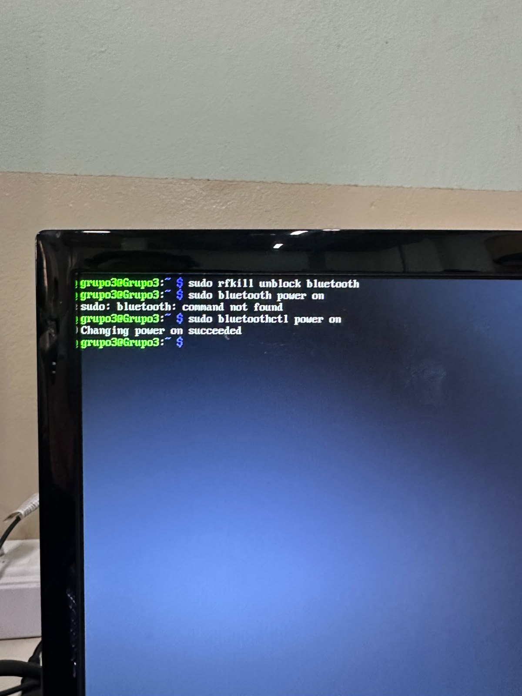
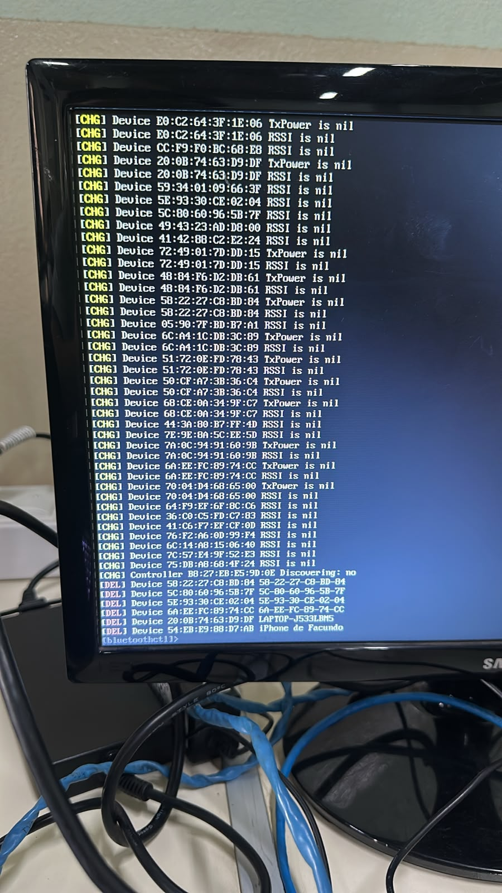
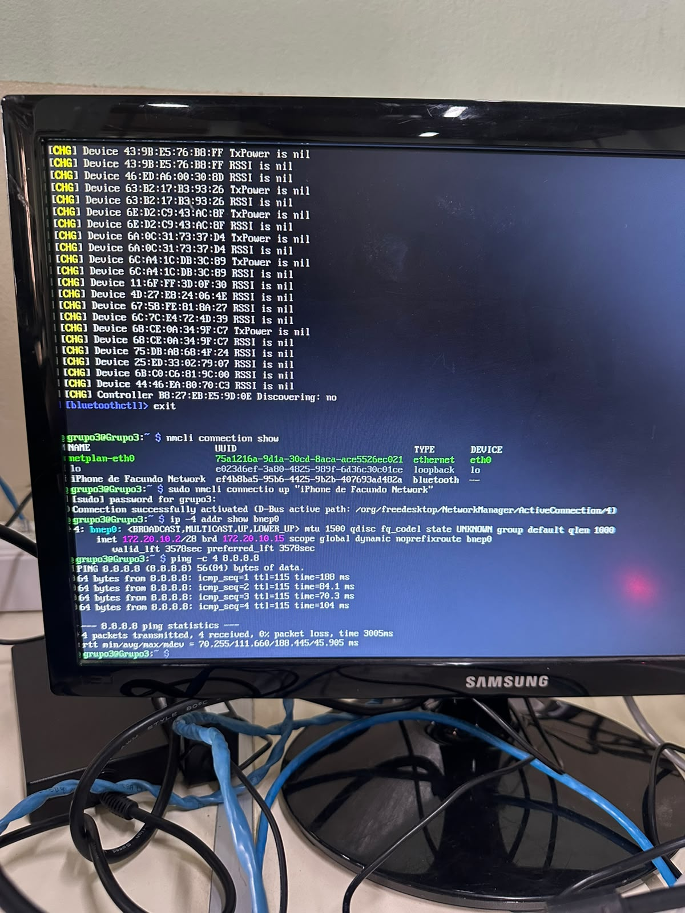
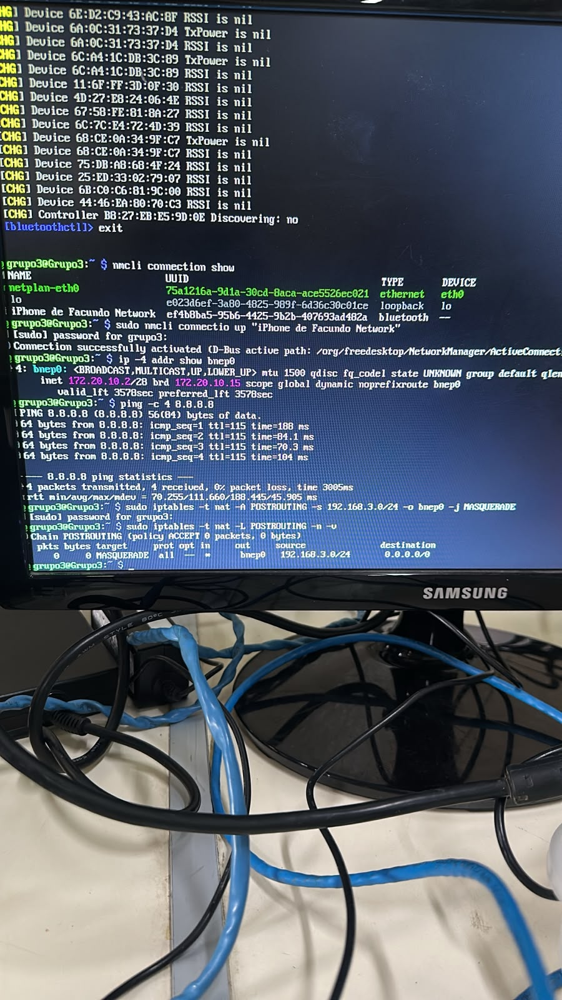
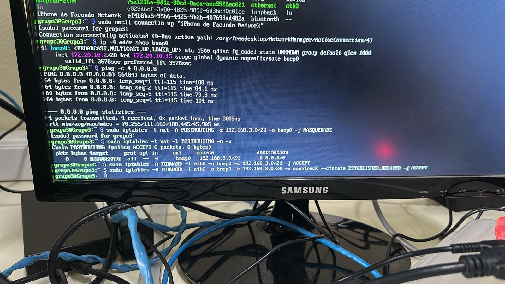
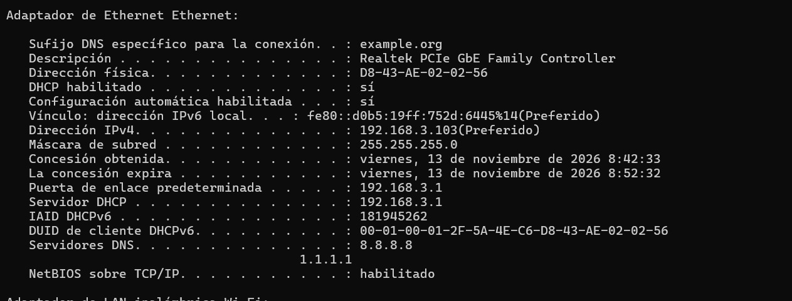
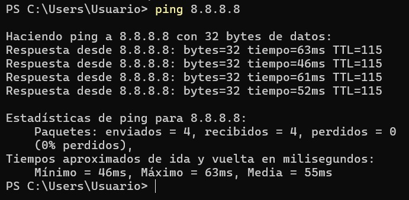
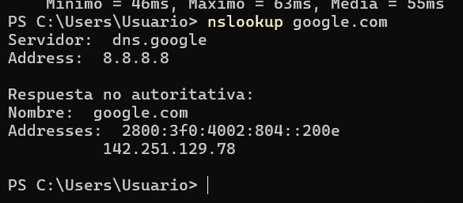
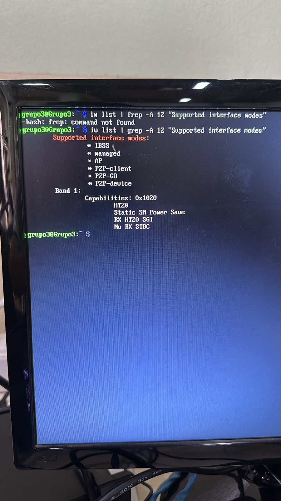
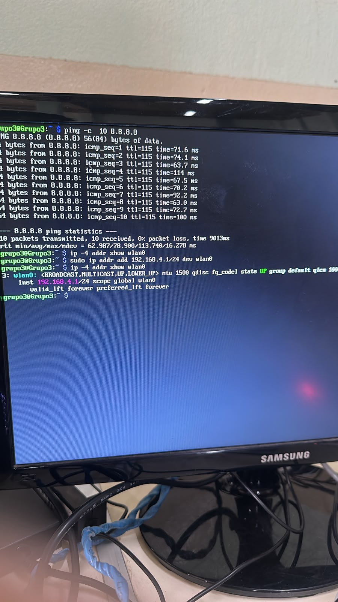

# Acceso a Internet por Bluetooth y redirección de tráfico en una Raspberry Pi (Raspberry Pi como router)

## Índice

- [Introducción](#introducción)
- [Objetivo del informe](#objetivo-del-informe)
- [Desarrollo teórico](#desarrollo-teórico)
  - [La Raspberry Pi como router](#la-raspberry-pi-como-router)
  - [Bluetooth y compartir Internet desde el celular](#bluetooth-y-compartir-internet-desde-el-celular)
  - [Interfaces de red involucradas](#interfaces-de-red-involucradas)
  - [NAT y enmascaramiento (MASQUERADE)](#nat-y-enmascaramiento-masquerade)
  - [iptables: tablas, cadenas y reglas](#iptables-tablas-cadenas-y-reglas)
  - [Seguimiento de conexiones (conntrack)](#seguimiento-de-conexiones-conntrack)
  - [DNS y resolución de nombres](#dns-y-resolución-de-nombres)
  - [Punto de acceso WiFi (Access Point)](#punto-de-acceso-wifi-access-point)
  - [Diseño de la red](#diseño-de-la-red)
- [Activación del Bluetooth](#activación-del-bluetooth)
- [Búsqueda de dispositivos](#búsqueda-de-dispositivos)
- [Conexión al celular y prueba de Internet](#conexión-al-celular-y-prueba-de-internet)
- [Configuración del NAT](#configuración-del-nat)
- [Permiso de tráfico entre Bluetooth y Ethernet](#permiso-de-tráfico-entre-bluetooth-y-ethernet)
- [Pruebas desde la notebook](#pruebas-desde-la-notebook)
  - [Configuración recibida por Ethernet](#configuración-recibida-por-ethernet)
  - [Conectividad a Internet](#conectividad-a-internet)
  - [Resolución de nombres (DNS)](#resolución-de-nombres-dns)
- [Verificación del modo Access Point](#verificación-del-modo-access-point)
- [Asignación de IP a la interfaz WiFi](#asignación-de-ip-a-la-interfaz-wifi)
- [Instalación y configuración del punto de acceso](#instalación-y-configuración-del-punto-de-acceso)
- [DHCP para la red inalámbrica](#dhcp-para-la-red-inalámbrica)
- [Reenvío de paquetes y NAT para la red WiFi](#reenvío-de-paquetes-y-nat-para-la-red-wifi)
- [Persistencia de la configuración](#persistencia-de-la-configuración)
- [Pruebas de la red inalámbrica](#pruebas-de-la-red-inalámbrica)
- [Resumen de la configuración final](#resumen-de-la-configuración-final)
- [Dificultades y aspectos a tener en cuenta](#dificultades-y-aspectos-a-tener-en-cuenta)
- [Conclusión](#conclusión)

---

## Introducción

En esta última etapa del trabajo integrador se busca que la **Raspberry Pi** cumpla un papel similar al de un **router hogareño**: obtener acceso a Internet y distribuirlo hacia los demás equipos de la red del grupo 3. En lugar de recibir Internet por un cable, la Raspberry lo obtiene a través de su interfaz **Bluetooth**, desde un celular que comparte su conexión de datos.

La configuración del **servidor DHCP** realizada en la entrega anterior se mantiene activa, de modo que los equipos conectados a la red local siguen recibiendo su dirección IP de forma automática. Sobre esa base se agrega la capacidad de **redirigir el tráfico** entre la interfaz Bluetooth (salida a Internet) y la interfaz Ethernet (conectada al switch), y también la interfaz WiFi, que se configura como punto de acceso para ofrecer acceso inalámbrico.

Este informe documenta el trabajo completo: la activación del Bluetooth, la conexión al celular, la configuración de NAT y de las reglas de reenvío, las comprobaciones desde la notebook, y la configuración del punto de acceso WiFi `Grupo3_2026` con su propio rango de direcciones, su servicio DHCP, el NAT correspondiente y las pruebas de navegación inalámbrica.

---

## Objetivo del informe

El objetivo es documentar el proceso de:

- Comprender cómo una Raspberry Pi puede actuar como router entre distintas interfaces de red.
- Activar la interfaz Bluetooth y conectarse a un celular que comparte su acceso a Internet.
- Verificar que la Raspberry obtenga una dirección IP y tenga conectividad a Internet por Bluetooth.
- Configurar **NAT** (enmascaramiento) para que los equipos de la red `192.168.3.0/24` salgan a Internet usando la conexión Bluetooth.
- Permitir el reenvío de tráfico entre la interfaz Bluetooth y la interfaz Ethernet.
- Comprobar desde una notebook conectada al switch la configuración de red recibida, el acceso a Internet y la resolución de nombres DNS.
- Verificar que la interfaz WiFi de la Raspberry admite el modo punto de acceso.
- Asignar una dirección IP a la interfaz WiFi y configurarla como punto de acceso con la red `Grupo3_2026`.
- Extender el servicio DHCP, el NAT y el reenvío de tráfico a la red inalámbrica.
- Comprobar que un dispositivo conectado por WiFi obtiene configuración de red, tiene acceso a Internet y resuelve nombres de dominio.
- Hacer persistentes las configuraciones que de otro modo se perderían al reiniciar.

---

# Desarrollo teórico

## La Raspberry Pi como router

Un **router** es un equipo que conecta redes distintas y **reenvía paquetes** entre ellas. Un router hogareño típico tiene una conexión hacia Internet (por ejemplo, un cable o fibra) y reparte esa conexión a los dispositivos de la casa, ya sea por cable o por WiFi. Además, suele ofrecer varios servicios integrados:

- **DHCP**, para entregar direcciones IP automáticamente.
- **NAT**, para que todos los dispositivos internos compartan una única dirección pública.
- **DNS**, para que los equipos puedan resolver nombres de dominio.
- **Punto de acceso WiFi**, para el acceso inalámbrico.

Una Raspberry Pi con Raspberry Pi OS (Linux) puede cumplir todas estas funciones combinando servicios de software. En este trabajo la Raspberry ya ofrecía DHCP desde la entrega anterior; en esta etapa se incorporan la salida a Internet por Bluetooth, el NAT y el reenvío de tráfico.

---

## Bluetooth y compartir Internet desde el celular

**Bluetooth** es una tecnología de comunicación inalámbrica de corto alcance. Además de conectar auriculares o teclados, permite crear una red de área personal (**PAN**, *Personal Area Network*) entre dos dispositivos. Cuando un celular activa la opción de **compartir Internet** (*tethering* o "zona con Bluetooth"), pone su conexión de datos móviles a disposición de otro dispositivo, que accede a Internet a través del celular.

En Linux, una conexión de red por Bluetooth aparece como una interfaz de red llamada **`bnep0`** (*Bluetooth Network Encapsulation Protocol*). Una vez establecida la conexión, esa interfaz recibe una dirección IP del celular y se utiliza como cualquier otra interfaz de red.

Las herramientas utilizadas para administrar el Bluetooth son:

- **`rfkill`**: permite bloquear o desbloquear dispositivos inalámbricos (WiFi, Bluetooth) a nivel de sistema.
- **`bluetoothctl`**: consola interactiva para controlar el adaptador Bluetooth, escanear y conectarse a dispositivos.
- **`nmcli`**: herramienta de línea de comandos de NetworkManager, que administra los perfiles de conexión, incluidas las conexiones Bluetooth.

---

## Interfaces de red involucradas

La Raspberry Pi trabaja en esta etapa con varias interfaces, cada una con una función distinta:

| Interfaz | Tipo | Función |
|---|---|---|
| `bnep0` | Bluetooth (PAN) | **Interfaz externa**: recibe Internet desde el celular. |
| `eth0` | Ethernet | **Interfaz interna**: conecta al switch y a la notebook con la red `192.168.3.0/24`. |
| `wlan0` | WiFi | **Interfaz interna inalámbrica**: ofrece la red `Grupo3_2026` como punto de acceso, con la IP `192.168.4.1/24`. |

La idea de un router es que el tráfico fluya desde las interfaces internas (`eth0`, `wlan0`) hacia la interfaz externa (`bnep0`) y que las respuestas vuelvan en sentido contrario.

---

## NAT y enmascaramiento (MASQUERADE)

La red `192.168.3.0/24` utiliza direcciones **privadas**, que no son enrutables en Internet. Para que los equipos de esa red puedan navegar se utiliza **NAT** (*Network Address Translation*, traducción de direcciones de red).

Con NAT, el router **reemplaza la dirección IP de origen** de los paquetes salientes por la suya propia en la interfaz externa, y recuerda esa traducción para devolver las respuestas al equipo que las originó. Para los servidores de Internet, todo el tráfico parece provenir de un único equipo.

Existe una variante llamada **MASQUERADE** (enmascaramiento), pensada para interfaces cuya dirección IP puede cambiar, como ocurre con una conexión compartida desde un celular. En lugar de fijar una dirección de salida, el sistema usa la que la interfaz tenga en cada momento.

---

## iptables: tablas, cadenas y reglas

**iptables** es la herramienta clásica de Linux para configurar el filtrado y la manipulación de paquetes del kernel. Sus conceptos principales son:

- **Tablas:** agrupan reglas según su finalidad. Las utilizadas aquí son `nat` (traducción de direcciones) y `filter` (permitir o bloquear tráfico, que es la tabla por defecto).
- **Cadenas:** puntos del recorrido de un paquete donde se aplican reglas. Algunas son:
  - `POSTROUTING`: se aplica a los paquetes justo antes de salir del equipo (en la tabla `nat`, donde se hace el enmascaramiento).
  - `FORWARD`: se aplica a los paquetes que **atraviesan** el equipo, entrando por una interfaz y saliendo por otra (en la tabla `filter`).
- **Reglas:** condiciones (origen, interfaz, estado) más una **acción** o *target*, como `MASQUERADE` o `ACCEPT`.

Las reglas se **agregan** al final de una cadena con `-A` y se **listan** con `-L`. Es importante saber que las reglas de iptables **no son persistentes**: se pierden al reiniciar la Raspberry, salvo que se guarden con un mecanismo adicional.

Para que Linux reenvíe paquetes entre interfaces, además, debe estar habilitado el **reenvío de paquetes IPv4** (`net.ipv4.ip_forward=1`).

---

## Seguimiento de conexiones (conntrack)

El módulo **conntrack** permite que el kernel haga un **seguimiento del estado de las conexiones**. Gracias a él, es posible escribir reglas que dependan del estado de un paquete:

- **`NEW`**: primer paquete de una conexión nueva.
- **`ESTABLISHED`**: paquete que pertenece a una conexión ya establecida.
- **`RELATED`**: paquete relacionado con una conexión existente (por ejemplo, ciertos mensajes de error ICMP).

Esto permite una política típica de router: dejar salir libremente el tráfico iniciado desde la red interna y permitir que **vuelvan solo las respuestas** a esas conexiones, sin aceptar conexiones nuevas iniciadas desde Internet hacia la red interna.

---

## DNS y resolución de nombres

**DNS** (*Domain Name System*) traduce nombres de dominio (por ejemplo, `google.com`) a direcciones IP. Sin DNS funcional, una red puede tener conectividad IP completa y, sin embargo, no permitir la navegación por nombre.

Por eso, además de comprobar el acceso por dirección IP (por ejemplo, `ping 8.8.8.8`), es necesario verificar que los equipos de la red puedan **resolver nombres**. Para esto se utiliza `nslookup`, que consulta al servidor DNS configurado y muestra qué servidor respondió y qué direcciones devolvió.

El servidor DHCP es el encargado habitual de informar a los clientes qué servidores DNS deben usar, junto con la dirección IP y la puerta de enlace.

---

## Punto de acceso WiFi (Access Point)

Un **punto de acceso** (*Access Point*, AP) es un dispositivo que permite que equipos inalámbricos se conecten a una red cableada mediante WiFi. Una Raspberry Pi puede funcionar como AP si su adaptador WiFi lo permite, utilizando un software como `hostapd`.

Cada adaptador WiFi soporta un conjunto de **modos de operación** (*interface modes*), como `managed` (cliente), `AP` (punto de acceso) o `monitor`. Para poder crear una red WiFi propia, el adaptador debe listar el modo **`AP`**. Esto se consulta con el comando `iw`, que muestra las capacidades del adaptador inalámbrico.

La red inalámbrica solicitada en la consigna tiene como SSID `Grupo3_2026` y una contraseña definida por el grupo.

Un punto de acceso también necesita una **red IP propia**. Como la interfaz `eth0` ya utiliza `192.168.3.0/24`, a la red inalámbrica se le asigna una subred distinta, `192.168.4.0/24`, para que el router pueda distinguir y enrutar el tráfico entre ambas. Así, la Raspberry tiene una dirección en cada red interna (`192.168.3.1` en `eth0` y `192.168.4.1` en `wlan0`), igual que un router hogareño con una LAN cableada y una WiFi.

Cada parte del servicio inalámbrico tiene un responsable distinto:

| Función | Responsable |
|---|---|
| Crear la red WiFi, autenticar con contraseña y cifrar (WPA2) | `hostapd` |
| Entregar direcciones IP a los clientes WiFi | Servidor DHCP (`isc-dhcp-server`) |
| Salir a Internet con la IP de Bluetooth | NAT (`MASQUERADE`) y reglas de `FORWARD` |

---

## Diseño de la red

El esquema de la red es el siguiente:

```text
   [Celular]  ~~~ Bluetooth (bnep0) ~~~  [Raspberry Pi]  --- eth0 --- [Switch] --- [Notebook]
  (comparte                               DHCP + NAT              192.168.3.0/24
   Internet)                              + reenvío
                                                  \
                                                   ~~~ wlan0 (Access Point "Grupo3_2026") ~~~ [Dispositivos WiFi]
                                                       192.168.4.1/24                      192.168.4.0/24
```

| Elemento | Función | Dato de red |
|---|---|---|
| Celular | Comparte su Internet por Bluetooth | Entrega una IP a la Raspberry en `bnep0` |
| Raspberry Pi | Router: DHCP, NAT y reenvío | `eth0` en la red `192.168.3.0/24` |
| Switch | Interconecta la Raspberry y la notebook | Sin IP necesaria para conmutar |
| Notebook | Cliente de la red cableada | Recibe su configuración por DHCP |
| Dispositivos WiFi | Clientes de la red inalámbrica `Grupo3_2026` | Reciben su configuración por DHCP en `192.168.4.0/24` |

> **Esquema 1:** Red del grupo 3 con salida a Internet por Bluetooth, acceso cableado por `eth0` y acceso inalámbrico por `wlan0`.

---

# Activación del Bluetooth

El primer paso fue activar la interfaz Bluetooth de la Raspberry:

```bash
sudo rfkill unblock bluetooth
sudo bluetoothctl power on
```

### Explicación de los comandos

- `sudo`: ejecuta la orden con privilegios de administrador.
- `rfkill`: herramienta que administra el bloqueo de dispositivos inalámbricos.
- `unblock bluetooth`: quita el bloqueo del Bluetooth a nivel de sistema, condición necesaria para poder usarlo.
- `bluetoothctl`: controla el adaptador Bluetooth.
- `power on`: enciende el adaptador Bluetooth.



> **Figura 1:** Desbloqueo y encendido del Bluetooth desde la terminal de la Raspberry.

---

# Búsqueda de dispositivos

Con el adaptador encendido, se inició una búsqueda de dispositivos cercanos desde la consola de `bluetoothctl`:

```text
scan on
```

### Explicación del comando

- `scan on`: comando de `bluetoothctl` que inicia el escaneo de dispositivos Bluetooth cercanos. Mientras está activo, se muestran en pantalla los dispositivos que se van detectando.

Durante el escaneo aparecieron muchos mensajes con el formato `[CHG] Device <dirección MAC> <campo> is nil`. Estos mensajes indican que `bluetoothctl` detectó cambios en la información de dispositivos cercanos (la dirección con letras y números es la **dirección MAC** de cada dispositivo). Es normal que aparezcan muchos, ya que se detectan todos los dispositivos Bluetooth del entorno.



> **Figura 2:** Escaneo con `scan on`. Se observan numerosos mensajes `[CHG] Device ... is nil` correspondientes a los dispositivos detectados.

---

# Conexión al celular y prueba de Internet

Para conectarse al celular que compartía Internet se revisaron los perfiles de conexión disponibles y se activó el correspondiente al teléfono:

```bash
nmcli connection show
sudo nmcli connection up "Iphone Facundo Network"
ip -4 addr show bnep0
ping -c 4 8.8.8.8
```

### Explicación de los comandos

- `nmcli connection show`: muestra la lista de perfiles de conexión conocidos por NetworkManager. Allí aparece el perfil de la conexión Bluetooth del celular.
- `sudo nmcli connection up "Iphone Facundo Network"`: activa el perfil indicado. El nombre va entre comillas porque contiene espacios. Al usar `sudo`, el sistema solicita la contraseña del usuario.
- `ip -4 addr show bnep0`: muestra la dirección IPv4 asignada a la interfaz Bluetooth `bnep0`. Si la conexión se estableció correctamente, el celular le entrega una dirección a la Raspberry.
- `ping -c 4 8.8.8.8`: envía mensajes ICMP a la dirección `8.8.8.8` (servidor DNS público de Google). `-c 4` limita la prueba a **4 envíos**. Si hay respuestas, la Raspberry tiene salida a Internet a través del celular.

Se comprobó que la interfaz `bnep0` recibió una dirección IP y que el `ping` obtuvo respuestas, lo que confirma que la Raspberry **accede a Internet por Bluetooth**.



> **Figura 3:** Activación de la conexión Bluetooth con el celular, dirección IP de `bnep0` y prueba con `ping -c 4 8.8.8.8`.

---

# Configuración del NAT

Para que los equipos de la red local puedan salir a Internet por la conexión Bluetooth, se configuró el enmascaramiento (NAT) en la salida `bnep0`:

```bash
sudo iptables -t nat -A POSTROUTING -s 192.168.3.0/24 -o bnep0 -j MASQUERADE
sudo iptables -t nat -L POSTROUTING -n -v
```

### Explicación de los comandos

- `iptables`: herramienta para configurar las reglas de filtrado y traducción de paquetes.
- `-t nat`: selecciona la tabla `nat`, donde se realiza la traducción de direcciones.
- `-A POSTROUTING`: **agrega** (*append*) una regla al final de la cadena `POSTROUTING`, que se aplica a los paquetes justo antes de salir.
- `-s 192.168.3.0/24`: la regla se aplica a los paquetes cuyo **origen** pertenece a la red local del grupo.
- `-o bnep0`: la regla se aplica a los paquetes que **salen** por la interfaz `bnep0` (Bluetooth).
- `-j MASQUERADE`: acción a realizar (*jump*): enmascarar la dirección de origen con la dirección que tenga `bnep0`.
- `-L POSTROUTING`: **lista** las reglas de la cadena `POSTROUTING`.
- `-n`: muestra direcciones y puertos en forma numérica, sin resolver nombres.
- `-v`: muestra información detallada, como contadores de paquetes y bytes.

La lista de reglas permitió comprobar que la regla de `MASQUERADE` quedó cargada.



> **Figura 4:** Regla de `MASQUERADE` agregada en la tabla `nat` y listado de la cadena `POSTROUTING`.

---

# Permiso de tráfico entre Bluetooth y Ethernet

Además del NAT, hace falta indicar qué tráfico puede atravesar la Raspberry. Se configuraron reglas en la cadena `FORWARD`: una que permite el tráfico de la red local hacia Bluetooth, y otra que permite el regreso de las respuestas:

```bash
sudo iptables -A FORWARD -s 192.168.3.0/24 -o bnep0 -j ACCEPT
sudo iptables -A FORWARD -i bnep0 -m conntrack --ctstate ESTABLISHED,RELATED -j ACCEPT
```

### Explicación de los comandos

- `-A FORWARD`: agrega una regla a la cadena `FORWARD`, que controla los paquetes que **atraviesan** la Raspberry entre dos interfaces.
- `-s 192.168.3.0/24 -o bnep0 -j ACCEPT`: **acepta** el tráfico que viene de la red local y sale por la interfaz Bluetooth. Es el camino de ida hacia Internet.
- `-i bnep0`: la segunda regla se aplica al tráfico que **entra** por la interfaz Bluetooth, es decir, el que vuelve de Internet.
- `-m conntrack`: carga el módulo de seguimiento de conexiones.
- `--ctstate ESTABLISHED,RELATED`: la regla solo coincide con paquetes que pertenecen a conexiones ya establecidas o relacionadas con ellas.
- `-j ACCEPT`: acepta los paquetes que cumplen la condición.

Con estas dos reglas, la red local puede iniciar conexiones hacia Internet y recibir sus respuestas, pero Internet no puede iniciar conexiones nuevas hacia la red local.



> **Figura 5:** Reglas de `iptables` que permiten el tráfico entre la red local y la interfaz Bluetooth.

---

# Pruebas desde la notebook

Para comprobar que la Raspberry realmente funciona como router, se realizaron pruebas desde una **notebook conectada al switch**, que forma parte de la red `192.168.3.0/24`.

## Configuración recibida por Ethernet

En la terminal de la notebook se consultó la configuración del adaptador Ethernet:

```cmd
ipconfig
```

### Explicación del comando

- `ipconfig`: comando de Windows que muestra la configuración de red de cada adaptador (dirección IPv4, máscara, puerta de enlace, etc.). En la salida se busca el apartado **"Adaptador de Ethernet Ethernet"**, que corresponde al cable conectado al switch.

En ese apartado se observan los datos de red recibidos por la notebook. Esto permite comprobar que la conexión por Ethernet funciona correctamente y que el equipo forma parte de la red del grupo.



> **Figura 6:** Captura en la notebook con los datos del apartado "Adaptador de Ethernet Ethernet".

---

## Conectividad a Internet

Desde la notebook se probó el acceso a Internet por dirección IP:

```cmd
ping 8.8.8.8
```

### Explicación del comando

- `ping`: envía mensajes ICMP Echo Request y espera respuestas Echo Reply.
- `8.8.8.8`: dirección IP de un servidor público de Internet.

Si el `ping` responde, significa que los paquetes de la notebook atraviesan la Raspberry, salen por Bluetooth hacia el celular y regresan: es decir, que el **NAT y el reenvío** están funcionando.



> **Figura 7:** Prueba de `ping 8.8.8.8` desde la notebook conectada por Ethernet.

---

## Resolución de nombres (DNS)

Para comprobar que los nombres de dominio también se resuelven correctamente, se utilizó:

```cmd
nslookup google.com
```

### Explicación del comando

- `nslookup`: herramienta que consulta a un servidor DNS.
- `google.com`: nombre de dominio que se desea resolver.

La salida indica qué servidor DNS respondió y qué direcciones IP corresponden al dominio. Esta prueba es importante porque, como pide la consigna, el servidor DNS debe estar correctamente configurado para resolver dominios externos y permitir la navegación.



> **Figura 8:** Resolución del nombre `google.com` con `nslookup` desde la notebook.

---

# Verificación del modo Access Point

Como paso previo a ofrecer la red inalámbrica `Grupo3_2026`, se verificó si el adaptador WiFi de la Raspberry admite el modo punto de acceso:

```bash
iw list | grep -A 12 "Supported interface modes"
```

### Explicación del comando

- `iw`: herramienta de configuración de dispositivos inalámbricos.
- `list`: muestra todas las capacidades del adaptador WiFi.
- `|`: tubería que envía la salida del primer comando al siguiente.
- `grep`: filtra el texto que coincide con un patrón.
- `-A 12`: muestra, además de la línea encontrada, las **12 líneas siguientes** (*After*).
- `"Supported interface modes"`: texto buscado, que introduce la lista de modos de operación admitidos.

En la lista se busca la línea **`* AP`**: si aparece, el adaptador puede funcionar como punto de acceso y, por lo tanto, la Raspberry puede ofrecer su propia red WiFi.



> **Figura 9:** Modos de interfaz admitidos por el adaptador WiFi, filtrados con `iw list | grep -A 12`.

---

# Asignación de IP a la interfaz WiFi

Confirmado que el adaptador admite el modo AP, el primer paso para convertir la Raspberry en punto de acceso es darle a `wlan0` una dirección IP propia. Esa dirección será la **puerta de enlace** de la red inalámbrica:

```bash
ip -4 addr show wlan0
sudo ip addr add 192.168.4.1/24 dev wlan0
ip -4 addr show wlan0
```

### Explicación de los comandos

- `ip -4 addr show wlan0`: muestra las direcciones IPv4 de la interfaz WiFi. La primera vez sirve para comprobar que `wlan0` **todavía no tiene dirección** en la red del punto de acceso.
- `sudo ip addr add 192.168.4.1/24 dev wlan0`: agrega la dirección `192.168.4.1` con máscara `/24` (`255.255.255.0`) a la interfaz `wlan0`. Se utiliza una subred distinta de la de Ethernet (`192.168.3.0/24`) para que cada red interna tenga su propio rango.
- `ip -4 addr show wlan0`: se ejecuta una segunda vez para comprobar que aparezca `inet 192.168.4.1/24`.

> **Nota:** como ocurrió con `eth0` en el trabajo de FTP, `ip addr add` configura una dirección **temporal**. Si desaparece, se vuelve a asignar y se verifica de nuevo antes de continuar.



> **Figura 10:** Asignación de la dirección `192.168.4.1/24` a `wlan0`, con la verificación antes y después del comando.

---

# Instalación y configuración del punto de acceso

Para que `wlan0` publique la red `Grupo3_2026` se utiliza **hostapd**, el programa que implementa el punto de acceso en Linux. La instalación se hace aprovechando la conexión a Internet que la Raspberry ya obtiene por Bluetooth.

## Preparación de la interfaz

Antes de iniciar el punto de acceso se desbloquea el WiFi, se establece el país de regulación y se evita que NetworkManager administre la interfaz, para que no interfiera con `hostapd`:

```bash
sudo rfkill unblock wifi
sudo iw reg set AR
sudo nmcli device set wlan0 managed no
```

### Explicación de los comandos

- `rfkill unblock wifi`: quita el bloqueo del WiFi a nivel de sistema, igual que se hizo con el Bluetooth.
- `iw reg set AR`: define el dominio regulatorio (Argentina), que determina los canales y potencias permitidos. Sin un país configurado, algunos adaptadores no habilitan el modo AP.
- `nmcli device set wlan0 managed no`: indica a NetworkManager que **no administre** `wlan0`. Así, la interfaz queda a cargo de `hostapd`. Si tras este paso la dirección `192.168.4.1/24` desaparece, se vuelve a asignar.

## Instalación de hostapd

```bash
sudo apt update
sudo apt install hostapd -y
sudo systemctl unmask hostapd
```

### Explicación de los comandos

- `apt update` y `apt install hostapd -y`: actualizan la lista de paquetes e instalan `hostapd`, igual que se hizo con `vsftpd`. Funcionan porque la Raspberry tiene Internet por `bnep0`.
- `systemctl unmask hostapd`: en Raspberry Pi OS el servicio se instala *enmascarado* (bloqueado) para que no inicie sin configuración. `unmask` quita ese bloqueo para poder habilitarlo después.

## Archivo de configuración

Se crea el archivo de configuración del punto de acceso:

```bash
sudo nano /etc/hostapd/hostapd.conf
```

Con el siguiente contenido:

```ini
interface=wlan0
driver=nl80211
ssid=Grupo3_2026
hw_mode=g
channel=6
country_code=AR
ieee80211n=1
wmm_enabled=1
auth_algs=1
wpa=2
wpa_key_mgmt=WPA-PSK
rsn_pairwise=CCMP
wpa_passphrase=<contraseña indicada en la consigna>
```

### Explicación de las directivas

- `interface=wlan0`: interfaz WiFi que actuará como punto de acceso.
- `driver=nl80211`: controlador estándar de Linux para adaptadores WiFi.
- `ssid=Grupo3_2026`: nombre de la red inalámbrica, según la consigna.
- `hw_mode=g` y `channel=6`: banda de 2,4 GHz y canal 6.
- `country_code=AR`: país de regulación, coherente con el comando `iw reg set`.
- `ieee80211n=1` y `wmm_enabled=1`: habilitan el estándar 802.11n y la priorización de tráfico (WMM).
- `auth_algs=1`: autenticación abierta de la capa de enlace, requerida por WPA2.
- `wpa=2`: utiliza WPA2.
- `wpa_key_mgmt=WPA-PSK`: autenticación con clave precompartida (la contraseña de la red).
- `rsn_pairwise=CCMP`: cifrado AES-CCMP, el recomendado para WPA2.
- `wpa_passphrase`: contraseña de la red, que debe tener entre 8 y 63 caracteres.

Luego se indica al servicio dónde está el archivo, editando `/etc/default/hostapd`:

```bash
sudo nano /etc/default/hostapd
```

```ini
DAEMON_CONF="/etc/hostapd/hostapd.conf"
```

- `DAEMON_CONF`: ruta del archivo de configuración que `hostapd` debe leer al iniciar.

## Puesta en marcha

```bash
sudo systemctl enable hostapd
sudo systemctl restart hostapd
sudo systemctl status hostapd
```

### Explicación de los comandos

- `enable`: configura el servicio para iniciar automáticamente en cada arranque.
- `restart`: inicia el servicio (o lo reinicia) aplicando la configuración.
- `status`: se debe observar **`Active: active (running)`**. Si el servicio falla, el estado muestra el motivo, que suele ser una directiva incorrecta o una interfaz controlada por otro programa.

Con el servicio activo, la red `Grupo3_2026` debería ser visible desde los dispositivos cercanos.

---

# DHCP para la red inalámbrica

El servidor DHCP configurado en la entrega anterior solo atiende la red cableada. Para que los dispositivos WiFi reciban dirección IP, puerta de enlace y DNS, se extiende ese mismo servicio a la nueva subred. En primer lugar se agrega `wlan0` a las interfaces que escucha el servidor:

```bash
sudo nano /etc/default/isc-dhcp-server
```

```ini
INTERFACESv4="eth0 wlan0"
```

- `INTERFACESv4`: lista de interfaces en las que el servidor DHCP atiende solicitudes IPv4. Se mantiene `eth0` y se suma `wlan0`.

Luego se agrega la nueva subred en el archivo de configuración principal:

```bash
sudo nano /etc/dhcp/dhcpd.conf
```

```ini
subnet 192.168.4.0 netmask 255.255.255.0 {
  range 192.168.4.100 192.168.4.200;
  option routers 192.168.4.1;
  option domain-name-servers 8.8.8.8, 8.8.4.4;
}
```

### Explicación de las directivas

- `subnet 192.168.4.0 netmask 255.255.255.0`: declara la red inalámbrica que el servidor va a atender.
- `range 192.168.4.100 192.168.4.200`: rango de direcciones que se entregan a los clientes WiFi.
- `option routers 192.168.4.1`: puerta de enlace que se informa a los clientes, es decir, la IP de `wlan0` en la Raspberry. Los paquetes con destino a Internet se envían a esta dirección.
- `option domain-name-servers 8.8.8.8, 8.8.4.4`: servidores DNS informados a los clientes, que permiten resolver nombres de dominio externos, tal como lo exige la consigna. La red cableada utiliza una opción equivalente en su propia subred.

Para aplicar los cambios se reinicia el servicio y se comprueba su estado:

```bash
sudo systemctl restart isc-dhcp-server
sudo systemctl status isc-dhcp-server
```

- `restart`: reinicia el servidor DHCP para que lea la nueva configuración.
- `status`: debe mostrar `active (running)`. El servicio solo inicia si `wlan0` ya tiene la dirección `192.168.4.1/24`, porque necesita una IP en la subred que va a atender.

---

# Reenvío de paquetes y NAT para la red WiFi

La red inalámbrica debe salir a Internet por `bnep0` igual que la cableada. Primero se comprueba que el reenvío IPv4 esté habilitado y, si no lo está, se activa:

```bash
cat /proc/sys/net/ipv4/ip_forward
sudo sysctl -w net.ipv4.ip_forward=1
```

### Explicación de los comandos

- `cat /proc/sys/net/ipv4/ip_forward`: muestra el valor actual del reenvío de paquetes. `0` significa deshabilitado y `1` habilitado.
- `sysctl -w net.ipv4.ip_forward=1`: activa el reenvío de paquetes entre interfaces, sin el cual la Raspberry no puede actuar como router. El cambio es inmediato pero no persiste tras un reinicio.

A continuación se agregan las reglas de NAT y de reenvío para la subred WiFi, siguiendo el mismo criterio que para la red cableada:

```bash
sudo iptables -t nat -A POSTROUTING -s 192.168.4.0/24 -o bnep0 -j MASQUERADE
sudo iptables -A FORWARD -s 192.168.4.0/24 -o bnep0 -j ACCEPT
sudo iptables -t nat -L POSTROUTING -n -v
sudo iptables -L FORWARD -n -v
```

### Explicación de los comandos

- `-t nat -A POSTROUTING -s 192.168.4.0/24 -o bnep0 -j MASQUERADE`: enmascara con la IP de `bnep0` los paquetes de la red WiFi que salen hacia Internet.
- `-A FORWARD -s 192.168.4.0/24 -o bnep0 -j ACCEPT`: permite el tráfico de la red WiFi hacia la interfaz Bluetooth.
- Las respuestas que vuelven de Internet ya están contempladas por la regla de `FORWARD` con `conntrack` (`ESTABLISHED,RELATED`) configurada para la red cableada, que se aplica a todo lo que entra por `bnep0` y por eso no requiere repetirse.
- `-L POSTROUTING -n -v` y `-L FORWARD -n -v`: listan las reglas con sus contadores. Se comprueba que existan las reglas de ambas subredes (`192.168.3.0/24` y `192.168.4.0/24`).

---

# Persistencia de la configuración

Varias de las configuraciones realizadas son **temporales** y se pierden al reiniciar la Raspberry. Para que el router funcione de nuevo sin repetir todo el procedimiento, se hacen persistentes las que corresponden.

**Reenvío de paquetes.** Se agrega la directiva en un archivo de configuración de `sysctl`:

```bash
echo "net.ipv4.ip_forward=1" | sudo tee /etc/sysctl.d/99-router.conf
sudo sysctl --system
```

- `echo "..." | sudo tee archivo`: escribe el texto en el archivo con permisos de administrador. Se utiliza `tee` porque la redirección `>` no hereda el `sudo`.
- `/etc/sysctl.d/99-router.conf`: archivo que el sistema lee en cada arranque.
- `sysctl --system`: vuelve a cargar todos los archivos de configuración de `sysctl`, aplicando el cambio sin reiniciar.

**Reglas de iptables.** Se instala el paquete que guarda y restaura las reglas automáticamente:

```bash
sudo apt install iptables-persistent -y
sudo netfilter-persistent save
```

- `iptables-persistent`: paquete que carga las reglas guardadas en cada arranque. Durante la instalación puede preguntar si se guardan las reglas actuales.
- `netfilter-persistent save`: guarda las reglas vigentes de `iptables` para que se restauren al iniciar.

**Servicios.** `hostapd` y `isc-dhcp-server` se habilitaron con `systemctl enable`, de modo que inician solos.

**Dirección de `wlan0`.** La IP `192.168.4.1/24` se asignó con `ip addr add` y, igual que en el trabajo de FTP, no persiste por sí sola. Tras un reinicio se vuelve a asignar con el mismo comando y luego se reinicia `isc-dhcp-server` si es necesario. Lo mismo ocurre con la conexión Bluetooth, que depende del celular y debe restablecerse.

---

# Pruebas de la red inalámbrica

Con el punto de acceso, el DHCP y el NAT configurados, se realizan las pruebas desde un dispositivo inalámbrico, que puede ser el celular o la notebook:

1. Se busca la red **`Grupo3_2026`** en la lista de redes WiFi y se ingresa la contraseña indicada en la consigna.
2. Se comprueba que el dispositivo obtenga una dirección del rango `192.168.4.100` a `192.168.4.200`, con puerta de enlace `192.168.4.1`.
3. Se verifica el acceso a Internet y la resolución de nombres. Desde una notebook con WiFi se utilizan los mismos comandos que en la red cableada:

```cmd
ipconfig
ping 8.8.8.8
nslookup google.com
```

- `ipconfig`: muestra la configuración del adaptador inalámbrico, donde se debe ver una dirección de la red `192.168.4.0/24`.
- `ping 8.8.8.8`: comprueba la salida a Internet a través de la Raspberry y del celular.
- `nslookup google.com`: comprueba que el DNS informado por el DHCP resuelve dominios externos.

4. Se abre una página web desde el navegador del dispositivo, que es la prueba final de que la navegación funciona.

Desde la Raspberry se puede confirmar el comportamiento del lado del servidor con los siguientes comandos:

```bash
sudo iw dev wlan0 station dump
sudo iptables -t nat -L POSTROUTING -n -v
```

- `iw dev wlan0 station dump`: lista los dispositivos actualmente asociados al punto de acceso.
- `iptables -t nat -L POSTROUTING -n -v`: los **contadores de paquetes** de la regla `MASQUERADE` aumentan a medida que los dispositivos WiFi generan tráfico hacia Internet.

De esta manera se comprueba toda la cadena: red WiFi, DHCP, reenvío, NAT, Bluetooth y DNS.

---

# Resumen de la configuración final

| Componente | Configuración |
|---|---|
| Salida a Internet | Bluetooth (`bnep0`), desde un celular que comparte su conexión |
| Red cableada | `eth0`, `192.168.3.0/24`, atendida por DHCP |
| Red inalámbrica | `wlan0`, SSID `Grupo3_2026`, WPA2, `192.168.4.0/24`, atendida por DHCP |
| Puerta de enlace de cada red | `192.168.3.1` (cableada) y `192.168.4.1` (inalámbrica) |
| NAT | `MASQUERADE` en `bnep0` para ambas subredes |
| Reenvío | `ip_forward=1` y reglas de `FORWARD` con seguimiento de conexiones |
| DNS | Informado a los clientes por el servidor DHCP |
| Servicios | `isc-dhcp-server` y `hostapd` habilitados para iniciar con el sistema |
| Elementos que no persisten por sí solos | IP de `wlan0` y conexión Bluetooth |

---

# Dificultades y aspectos a tener en cuenta

- **Reglas no persistentes:** las reglas de `iptables` se pierden al reiniciar la Raspberry. Si se reinicia, hay que volver a cargarlas o configurar un mecanismo para guardarlas.
- **Dirección variable en Bluetooth:** la dirección IP de `bnep0` la entrega el celular y puede cambiar. Por eso se utiliza `MASQUERADE` en lugar de una traducción con dirección fija.
- **Reenvío de paquetes:** para que la Raspberry reenvíe tráfico entre interfaces debe estar habilitado el reenvío IPv4 del kernel (`net.ipv4.ip_forward=1`).
- **Nombre de la interfaz:** la interfaz Bluetooth (`bnep0`) solo existe mientras la conexión con el celular está activa. Si la conexión se corta, las reglas que la mencionan dejan de ser útiles hasta que se restablezca.
- **Conexión del celular:** la conexión depende de que el celular tenga activada la opción de compartir Internet por Bluetooth y de que tenga datos disponibles.
- **Interfaz WiFi y NetworkManager:** si NetworkManager administra `wlan0`, puede entrar en conflicto con `hostapd`. Por eso se configuró la interfaz como no administrada.
- **Servicio DHCP y `wlan0`:** `isc-dhcp-server` no inicia si la interfaz que debe atender no tiene una IP en su subred, por lo que la dirección de `wlan0` se asigna antes de reiniciarlo.
- **Subredes distintas:** cada interfaz interna necesita su propia subred (`192.168.3.0/24` y `192.168.4.0/24`); si se usara la misma, el router no podría decidir hacia qué interfaz enviar los paquetes.
- **Contraseña de la red:** `wpa_passphrase` debe tener entre 8 y 63 caracteres; de lo contrario `hostapd` no inicia.

---

# Conclusión

En esta etapa se logró que la **Raspberry Pi obtenga acceso a Internet a través de su interfaz Bluetooth**, utilizando un celular que comparte su conexión, y que se comporte como un **router** para la red del grupo 3.

Se activó el Bluetooth, se estableció la conexión con el celular y se verificó que la interfaz `bnep0` recibiera una dirección IP y tuviera conectividad. Luego se configuró **NAT** mediante `MASQUERADE` y se agregaron reglas de reenvío para permitir el tráfico entre la red local y el Bluetooth, manteniendo la política de aceptar solo las respuestas a las conexiones iniciadas desde la red interna.

Desde una notebook conectada por Ethernet al switch se comprobó la configuración de red recibida, el acceso a Internet y la resolución de nombres con `nslookup`, que son las tres condiciones necesarias para poder navegar. Después se verificó que el adaptador WiFi admite el modo punto de acceso, se le asignó la dirección `192.168.4.1/24` y se configuró con `hostapd` la red inalámbrica `Grupo3_2026` con WPA2. Para completar el funcionamiento como router hogareño, se extendió el servicio DHCP a la nueva subred, se agregó el NAT y el reenvío para las direcciones inalámbricas y se hicieron persistentes el reenvío de paquetes y las reglas del cortafuegos.

Como aprendizaje principal, se comprendió que un router combina varias funciones (conexión hacia Internet, NAT, reenvío de paquetes, DHCP, DNS y punto de acceso inalámbrico) y que cada una debe comprobarse por separado: tener Internet en la Raspberry no garantiza que la tengan los equipos de la red. También se observó que cada red interna necesita su propia subred y su propia puerta de enlace, y que la configuración temporal (direcciones asignadas con `ip addr add`, reglas de `iptables`) debe hacerse persistente para que el servicio sobreviva a un reinicio. El resultado es una Raspberry Pi que ofrece, a partir de la conexión de un celular, acceso a Internet cableado e inalámbrico como lo haría un router hogareño.
