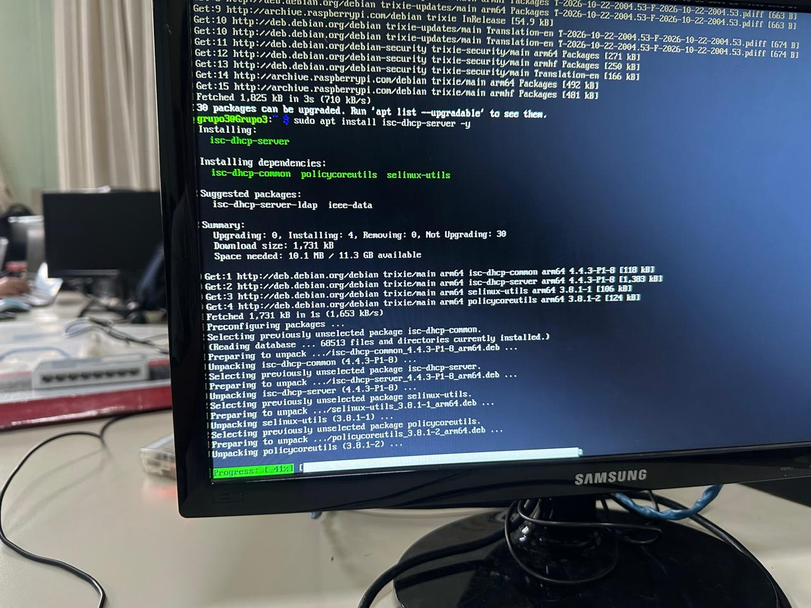
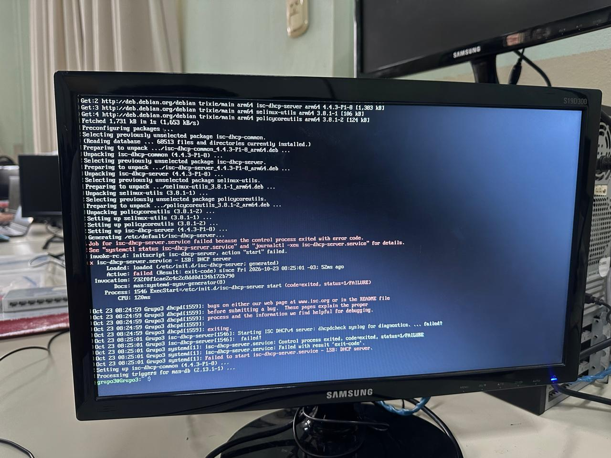
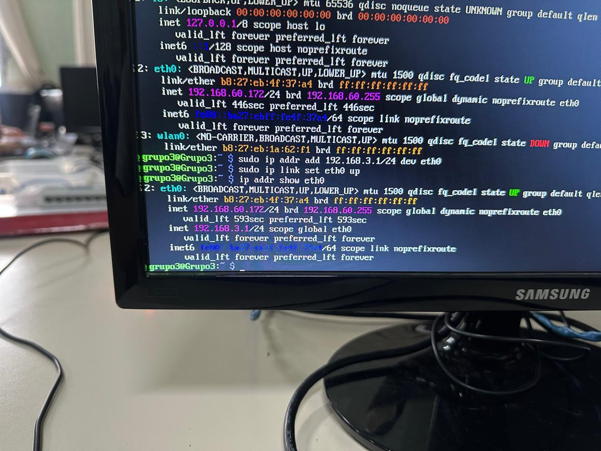
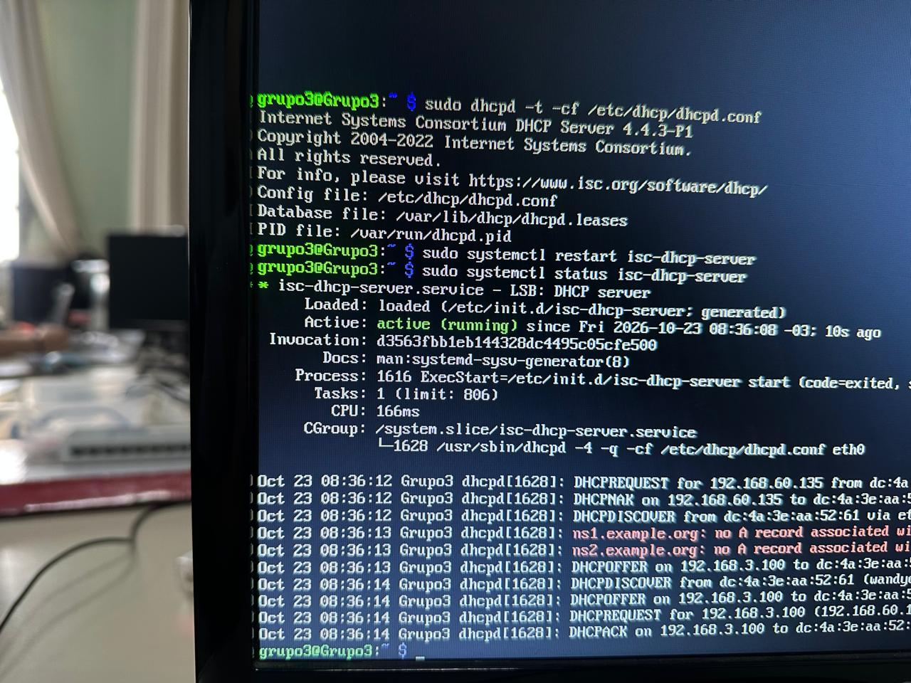
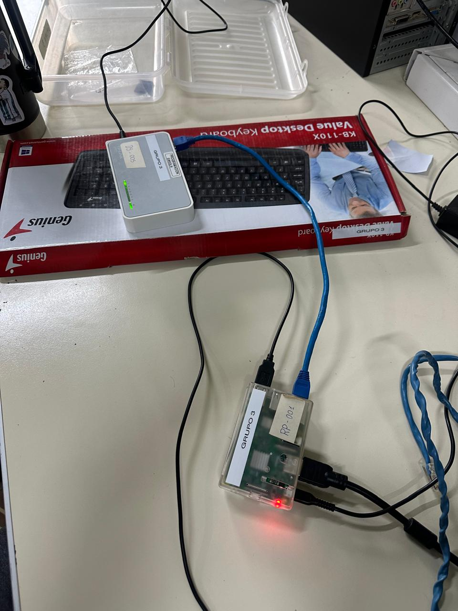
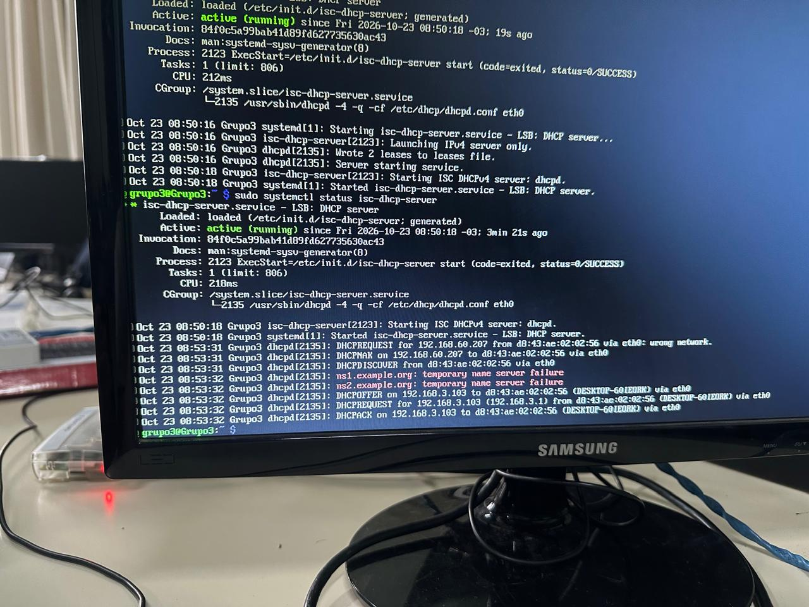
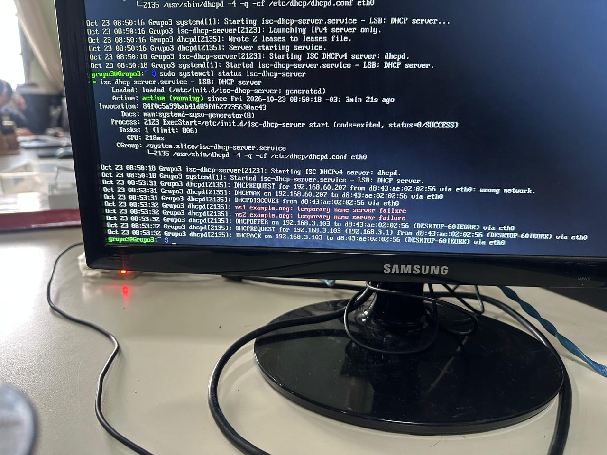
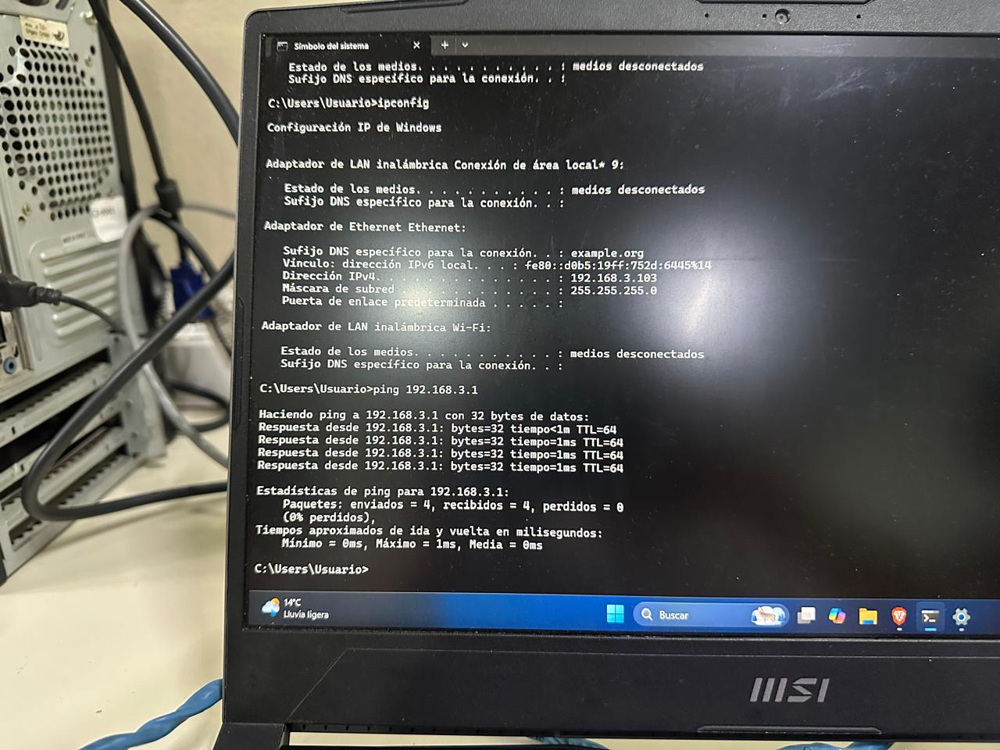

# Instalación y configuración del servicio DHCP en una Raspberry Pi

## Índice

- [Instalación y configuración del servicio DHCP en una Raspberry Pi](#instalación-y-configuración-del-servicio-dhcp-en-una-raspberry-pi)
  - [Índice](#índice)
  - [Introducción](#introducción)
  - [Objetivo del informe](#objetivo-del-informe)
- [Desarrollo teórico](#desarrollo-teórico)
  - [Red LAN y switch](#red-lan-y-switch)
  - [Dirección IP y máscara de subred](#dirección-ip-y-máscara-de-subred)
  - [Protocolo DHCP](#protocolo-dhcp)
  - [Proceso de asignación de una IP (DORA)](#proceso-de-asignación-de-una-ip-dora)
  - [Diseño de la red](#diseño-de-la-red)
- [Instalación del servicio DHCP](#instalación-del-servicio-dhcp)
  - [Actualización de la lista de paquetes](#actualización-de-la-lista-de-paquetes)
  - [Instalación del servidor DHCP](#instalación-del-servidor-dhcp)
- [Asignación de una IP estática a la Raspberry Pi](#asignación-de-una-ip-estática-a-la-raspberry-pi)
  - [Identificación de la interfaz de red](#identificación-de-la-interfaz-de-red)
  - [Asignación de la dirección IP](#asignación-de-la-dirección-ip)
  - [Verificación](#verificación)
- [Configuración del servidor DHCP](#configuración-del-servidor-dhcp)
  - [Archivo de configuración principal](#archivo-de-configuración-principal)
  - [Selección de la interfaz de red](#selección-de-la-interfaz-de-red)
- [Conexión física de la red](#conexión-física-de-la-red)
- [Puesta en marcha del servicio](#puesta-en-marcha-del-servicio)
  - [Comprobación de la sintaxis](#comprobación-de-la-sintaxis)
  - [Reinicio y verificación del servicio](#reinicio-y-verificación-del-servicio)
  - [Inicio automático del servicio](#inicio-automático-del-servicio)
- [Prueba de funcionamiento](#prueba-de-funcionamiento)
  - [Obtención de IP en la notebook](#obtención-de-ip-en-la-notebook)
  - [Prueba de conectividad con ping](#prueba-de-conectividad-con-ping)
- [Conclusión](#conclusión)

---

## Introducción

En este informe se documenta el proceso realizado para instalar y configurar un servidor **DHCP** en una **Raspberry Pi**, de modo que sea la encargada de entregar direcciones IP de forma automática a los dispositivos de la red LAN de cada grupo.

La **Raspberry Pi** es una computadora de placa reducida, de bajo costo y consumo, que en esta actividad funciona como servidor dentro de una red local. Para brindar el servicio se utilizó el paquete **isc-dhcp-server**, una de las implementaciones más difundidas de DHCP en sistemas Linux.

La red que se implementó es la **192.168.3.0/24**, correspondiente al **grupo 3** (192.168.*número de grupo*.0). Todos los equipos se conectan a un **switch**, que forma la red LAN: allí se conectan tanto la Raspberry Pi como las notebooks de los integrantes del grupo.

---

## Objetivo del informe

El objetivo de este informe es documentar el proceso de:

* Instalación de un servidor DHCP básico en la Raspberry Pi.
* Asignación de una dirección IP estática a la Raspberry Pi dentro de la red del grupo.
* Configuración del servidor DHCP para que entregue direcciones en la red `192.168.3.0/24`.
* Armado de la red LAN física utilizando un switch.
* Comprobación del funcionamiento conectando una notebook y verificando que reciba una IP automáticamente.
* Representación del diseño de la red mediante un diagrama realizado en Packet Tracer.

De esta manera, la Raspberry Pi queda lista para que los equipos del grupo se conecten a ella y generen la red LAN.

---

# Desarrollo teórico

## Red LAN y switch

Una **red LAN** (*Local Area Network*, red de área local) es una red que conecta equipos dentro de un área reducida, como un aula, una oficina o una casa. Permite que los dispositivos se comuniquen entre sí y compartan recursos.

Un **switch** es el dispositivo que interconecta los equipos de una red LAN. Recibe los datos por uno de sus puertos y los envía únicamente al puerto del equipo de destino, lo que lo hace más eficiente que un hub. En este trabajo cada grupo utiliza su propio switch, al que se conectan la Raspberry Pi y las notebooks.

---

## Dirección IP y máscara de subred

Una **dirección IP** es un identificador numérico que tiene cada dispositivo dentro de una red y que permite ubicarlo para enviarle y recibir datos. En IPv4 se escribe con cuatro números entre 0 y 255 separados por puntos, por ejemplo `192.168.3.1`.

La **máscara de subred** indica qué parte de la dirección corresponde a la **red** y qué parte a los **equipos**. En este trabajo se utiliza `255.255.255.0`, que también se escribe como `/24`. Esto significa que los primeros tres números (`192.168.3`) identifican la red, y el último número identifica a cada equipo (de 1 a 254).

Dos direcciones tienen un uso especial en cada red:

* **Dirección de red** (`192.168.3.0`): identifica a la red en sí misma.
* **Dirección de broadcast** (`192.168.3.255`): se usa para enviar un mensaje a todos los equipos de la red al mismo tiempo.

---

## Protocolo DHCP

**DHCP** (*Dynamic Host Configuration Protocol*, protocolo de configuración dinámica de host) es un protocolo que permite que los dispositivos de una red reciban su configuración de red de forma **automática**, sin que el usuario tenga que cargarla a mano en cada equipo.

El servidor DHCP entrega a los clientes, como mínimo:

* Una **dirección IP** libre, tomada de un rango definido.
* La **máscara de subred**.

Opcionalmente puede entregar también la puerta de enlace (*gateway*), los servidores DNS y otros datos.

Las direcciones se entregan en préstamo por un tiempo limitado llamado **tiempo de concesión** (*lease time*). Cuando ese tiempo termina, el cliente debe renovar la IP o la pierde, y el servidor puede asignársela a otro equipo. Esto evita conflictos por IP repetidas y facilita mucho la administración de la red.

---

## Proceso de asignación de una IP (DORA)

Cuando un equipo se conecta a la red y está configurado para obtener IP automáticamente, se produce un intercambio de cuatro mensajes conocido como **DORA**:

| Paso | Mensaje | Qué ocurre |
|---|---|---|
| 1 | **D**iscover | El cliente envía un mensaje de broadcast preguntando si hay algún servidor DHCP disponible. |
| 2 | **O**ffer | El servidor responde ofreciendo una IP libre del rango. |
| 3 | **R**equest | El cliente acepta la oferta y solicita formalmente esa IP. |
| 4 | **A**cknowledge | El servidor confirma la asignación y registra la concesión. |

---

## Diseño de la red

La red del grupo se compone de dos tipos de equipos conectados al mismo switch:

| Equipo | Rol | Dirección IP |
|---|---|---|
| Raspberry Pi | Servidor DHCP | `192.168.3.1` (estática) |
| Notebooks | Clientes DHCP | Entre `192.168.3.100` y `192.168.3.200` (dinámica) |

El servidor debe tener una IP **estática** (fija) porque los clientes necesitan saber siempre dónde está; si su propia dirección cambiara, la red dejaría de funcionar. Los clientes, en cambio, reciben una IP dinámica del rango definido.

Este diseño se representó en un diagrama de **Packet Tracer**, que permite visualizar claramente cómo se conectan los dispositivos:


> **Figura 1:** Diagrama de la red LAN del grupo realizado en Packet Tracer, con la Raspberry Pi (servidor DHCP) y las notebooks conectadas a un mismo switch.

---

# Instalación del servicio DHCP

Antes de comenzar, se accedió a la Raspberry Pi por terminal.

## Actualización de la lista de paquetes

Primero se actualizó la lista de paquetes disponibles para asegurar que se instalen las versiones más recientes:

```bash
sudo apt update
```

### Explicación del comando

* `sudo`: ejecuta el comando con privilegios de administrador, necesarios para modificar el sistema.
* `apt`: es el gestor de paquetes de los sistemas basados en Debian, como Raspberry Pi OS. Permite instalar, actualizar y eliminar software.
* `update`: descarga desde los repositorios la lista actualizada de paquetes disponibles y sus versiones. **No instala ni actualiza programas**: solo actualiza el listado que `apt` consulta.

---

## Instalación del servidor DHCP

A continuación se instaló el servicio DHCP:

```bash
sudo apt install isc-dhcp-server -y
```



> **Figura 2:** Inicio de la instalación del paquete `isc-dhcp-server`.

### Explicación del comando

* `sudo apt install`: instala paquetes con privilegios de administrador (explicado anteriormente).
* `isc-dhcp-server`: paquete que contiene el servidor DHCP desarrollado por el *Internet Systems Consortium* (ISC). Instala el servicio `isc-dhcp-server` y el programa `dhcpd`, que es el que atiende las solicitudes de los clientes.
* `-y`: responde automáticamente "sí" a la pregunta de confirmación que `apt` realiza antes de instalar, evitando tener que escribirla manualmente.



> **Figura 3:** Finalización de la instalación, donde se observa el mensaje de error al intentar iniciar el servicio.

Al finalizar la instalación apareció un **error indicando que el servicio no pudo iniciarse**. Esto es **normal y esperado**: el servidor se instala sin ninguna configuración, por lo que no sabe en qué red ni en qué interfaz debe trabajar. El error desaparece una vez que se lo configura correctamente.

---

# Asignación de una IP estática a la Raspberry Pi

Como se explicó en el desarrollo teórico, el servidor DHCP necesita una dirección IP fija dentro de la red que va a administrar.

## Identificación de la interfaz de red

Primero se consultó el nombre de la interfaz de red por cable (Ethernet) de la Raspberry Pi:

```bash
ip a
```

### Explicación del comando

* `ip`: herramienta de Linux para consultar y configurar la red del equipo.
* `a`: abreviatura de `addr` (*address*, direcciones). Muestra todas las interfaces de red del equipo junto con sus direcciones IP.

En la salida se identificó la interfaz Ethernet, cuyo nombre es **`eth0`**.

---

## Asignación de la dirección IP

Luego se asignó la dirección IP a esa interfaz y se la activó:

```bash
sudo ip addr add 192.168.3.1/24 dev eth0
sudo ip link set eth0 up
```



> **Figura 4:** Asignación de la dirección IP estática `192.168.3.1/24` a la interfaz `eth0`.

### Explicación de los comandos

**`sudo ip addr add 192.168.3.1/24 dev eth0`**

* `sudo`: ejecuta el comando con privilegios de administrador.
* `ip addr`: administra las direcciones IP de las interfaces.
* `add`: indica que se desea **agregar** una dirección a la interfaz.
* `192.168.3.1/24`: dirección IP que se asigna, seguida de la máscara en notación abreviada. `/24` equivale a `255.255.255.0`.
* `dev eth0`: indica el dispositivo (*device*) al que se asigna la dirección, en este caso la interfaz Ethernet.

**`sudo ip link set eth0 up`**

* `ip link`: administra el estado de las interfaces de red (a diferencia de `ip addr`, que administra sus direcciones).
* `set eth0`: indica que se va a modificar la interfaz `eth0`.
* `up`: activa la interfaz, es decir, la "enciende" para que pueda enviar y recibir datos.

> **Nota:** una dirección asignada con `ip addr add` es **temporal**: se pierde al reiniciar la Raspberry Pi. Para que sea permanente habría que definirla en el archivo de configuración de red del sistema.

---

## Verificación

Para comprobar que la dirección quedó asentada se ejecutó:

```bash
ip addr show eth0
```

### Explicación del comando

* `ip addr show`: muestra la información de las direcciones de red.
* `eth0`: limita la consulta únicamente a esa interfaz.

En la salida debe aparecer la línea `inet 192.168.3.1/24`, lo que confirma que la dirección fue asignada correctamente.

---

# Configuración del servidor DHCP

## Archivo de configuración principal

El servidor DHCP se configura mediante el archivo `/etc/dhcp/dhcpd.conf`. Se abrió con un editor de texto:

```bash
sudo nano /etc/dhcp/dhcpd.conf
```

### Explicación del comando

* `sudo`: ejecuta el comando con privilegios de administrador, necesarios para modificar archivos del sistema.
* `nano`: editor de texto de terminal, sencillo de utilizar.
* `/etc/dhcp/dhcpd.conf`: ruta del archivo de configuración del servidor DHCP (`dhcpd`).

Dentro del archivo se escribió la siguiente configuración:

```text
authoritative;

subnet 192.168.3.0 netmask 255.255.255.0 {
    range 192.168.3.100 192.168.3.200;
    option subnet-mask 255.255.255.0;
    option broadcast-address 192.168.3.255;
    default-lease-time 600;
    max-lease-time 7200;
}
```

### Explicación de las opciones

* `authoritative;`: indica que este servidor es el DHCP **autorizado** para esa red. Si un cliente pide una IP incorrecta, el servidor le responde y le obliga a pedir una nueva.
* `subnet 192.168.3.0 netmask 255.255.255.0 { ... }`: define la **red** que administrará el servidor, con su dirección de red y su máscara. Todas las opciones siguientes se aplican dentro de esa subred.
* `range 192.168.3.100 192.168.3.200;`: establece el **rango de IP** que el servidor puede entregar. Se entregarán direcciones desde la `.100` hasta la `.200`, dejando fuera la `.1` (Raspberry Pi) para evitar conflictos.
* `option subnet-mask 255.255.255.0;`: máscara de subred que se entrega a los clientes.
* `option broadcast-address 192.168.3.255;`: dirección de difusión (*broadcast*) de la red, que también se entrega a los clientes.
* `default-lease-time 600;`: duración predeterminada de la concesión, en segundos (600 s = 10 minutos).
* `max-lease-time 7200;`: duración máxima de la concesión, en segundos (7200 s = 2 horas), para los clientes que soliciten un tiempo mayor al predeterminado.

> **Gateway:** en esta configuración **no se definió una puerta de enlace** (`option routers`), porque la red LAN, por ahora, no tiene un router que le proporcione salida a Internet. Si más adelante se agregara uno, habría que incorporar esa opción.

Para guardar los cambios en `nano` se presiona `Ctrl + O` y `Enter`, y para salir `Ctrl + X`.

---

## Selección de la interfaz de red

Además, hay que indicarle al servicio **en qué interfaz** debe escuchar las solicitudes de los clientes. Para eso se edita otro archivo:

```bash
sudo nano /etc/default/isc-dhcp-server
```

### Explicación del comando

* `sudo nano`: abre un archivo con el editor `nano` con privilegios de administrador.
* `/etc/default/isc-dhcp-server`: archivo donde se definen los parámetros con los que arranca el servicio.

Dentro del archivo se estableció la interfaz Ethernet en la opción correspondiente a IPv4:

```text
INTERFACESv4="eth0"
```

### Explicación de la opción

* `INTERFACESv4`: lista de interfaces en las que el servidor atenderá solicitudes DHCP para direcciones IPv4.
* `"eth0"`: interfaz Ethernet de la Raspberry Pi, que es la conectada al switch. Si no se configura, el servicio no sabe por dónde escuchar y no inicia.

---

# Conexión física de la red

Una vez realizadas las configuraciones anteriores, se armó la red física: se conectó la **Raspberry Pi** al **switch** del grupo mediante un cable de red, y se encendió el switch.



> **Figura 5:** Raspberry Pi conectada y encendida junto al switch que forma la red LAN del grupo.

Con la Raspberry Pi conectada al switch, se continuó con la puesta en marcha del servicio.

---

# Puesta en marcha del servicio

## Comprobación de la sintaxis

Antes de iniciar el servicio se verificó que el archivo de configuración no tuviera errores:

```bash
sudo dhcpd -t -cf /etc/dhcp/dhcpd.conf
```

### Explicación del comando

* `sudo`: ejecuta el comando con privilegios de administrador.
* `dhcpd`: programa del servidor DHCP.
* `-t`: modo de prueba (*test*). Revisa la sintaxis del archivo de configuración sin iniciar el servicio.
* `-cf /etc/dhcp/dhcpd.conf`: indica la ruta del archivo de configuración (*config file*) que se desea revisar.

Si el archivo no tiene errores, el comando finaliza sin mostrar mensajes de error. Si hay algún problema, indica la línea donde se encuentra, lo que facilita corregirlo.

---

## Reinicio y verificación del servicio

Con la configuración correcta, se reinició el servicio para que la lea y se consultó su estado:

```bash
sudo systemctl restart isc-dhcp-server
sudo systemctl status isc-dhcp-server
```



> **Figura 6:** Estado del servicio `isc-dhcp-server` luego de reiniciarlo, mostrando `active (running)`.

### Explicación de los comandos

**`sudo systemctl restart isc-dhcp-server`**

* `sudo`: ejecuta el comando con privilegios de administrador.
* `systemctl`: herramienta que permite consultar y administrar los servicios del sistema.
* `restart`: detiene el servicio y lo vuelve a iniciar, de modo que lea nuevamente su configuración.
* `isc-dhcp-server`: nombre del servicio sobre el que se actúa.

**`sudo systemctl status isc-dhcp-server`**

* `status`: muestra el estado actual del servicio.

El resultado debe indicar **`active (running)`**, lo que significa que el servidor DHCP está funcionando. A diferencia de lo ocurrido durante la instalación, ahora el servicio inicia correctamente porque ya está configurado.

---

## Inicio automático del servicio

Para que el servidor DHCP se inicie solo cada vez que se enciende la Raspberry Pi, se habilitó su inicio automático:

```bash
sudo systemctl enable isc-dhcp-server
```

### Explicación del comando

* `sudo systemctl`: administra servicios con privilegios de administrador (explicado anteriormente).
* `enable`: configura el servicio para que se **inicie automáticamente en cada arranque** del sistema. No lo inicia en ese momento; solo lo deja programado para los próximos encendidos.
* `isc-dhcp-server`: servicio sobre el que se actúa.

Luego se volvió a consultar el estado para confirmar que el servicio seguía activo:

```bash
sudo systemctl status isc-dhcp-server
```



> **Figura 7:** Estado del servicio luego de habilitar el inicio automático, que continúa en `active (running)`.

---

# Prueba de funcionamiento

## Obtención de IP en la notebook

Para comprobar el funcionamiento, se conectó una **notebook** al switch mediante un cable de red y se configuró su adaptador Ethernet para **obtener la dirección IP automáticamente**.



> **Figura 8:** Configuración de red de la notebook, que recibió una dirección IP del rango definido en el servidor DHCP.

La notebook recibió una dirección dentro del rango `192.168.3.100 – 192.168.3.200`, lo que demuestra que el servidor DHCP de la Raspberry Pi responde a las solicitudes y entrega direcciones correctamente.

---

## Prueba de conectividad con ping

Finalmente, se comprobó la comunicación entre la notebook y la Raspberry Pi. Desde la notebook se ejecutó:

```bash
ping 192.168.3.1
```



> **Figura 9:** Resultado del comando `ping` desde la notebook hacia la Raspberry Pi, con respuestas recibidas.

### Explicación del comando

* `ping`: herramienta que envía pequeños paquetes de prueba (mensajes ICMP) a otro equipo y espera su respuesta. Sirve para comprobar si dos equipos tienen conectividad.
* `192.168.3.1`: dirección IP de la Raspberry Pi, que es el equipo al que se envían los paquetes.

Como el comando muestra respuestas (*Reply*) y no pérdida de paquetes, se confirma que existe comunicación entre la notebook y la Raspberry Pi y que la red LAN funciona correctamente.

---

# Conclusión

A partir de esta actividad se logró instalar y configurar un servidor **DHCP** en la Raspberry Pi, que quedó funcionando como servidor de la red LAN `192.168.3.0/24` del grupo.

Se instaló el paquete `isc-dhcp-server`, que al principio mostró un error de inicio por no estar configurado. Se le asignó a la Raspberry Pi una **IP estática** (`192.168.3.1/24`) en la interfaz `eth0`, se definió en `dhcpd.conf` la subred, el rango de direcciones (`.100` a `.200`) y los tiempos de concesión, y se indicó en `/etc/default/isc-dhcp-server` la interfaz por la que el servicio debe escuchar. Luego se verificó la sintaxis, se reinició el servicio y se habilitó su inicio automático.

Finalmente, se conectó una notebook al switch y se comprobó que **recibió una dirección IP automáticamente** y que pudo comunicarse con la Raspberry Pi mediante `ping`, confirmando que la red funciona.

Como aprendizaje principal, se comprendió que el servidor DHCP necesita una dirección **fija** para poder atender a los clientes, mientras que estos reciben una dirección **dinámica** de un rango previamente definido, lo que evita configurar cada equipo a mano. También se tuvo en cuenta que, al no haber un router en la red, no se definió una puerta de enlace, y que la IP asignada con `ip addr add` es temporal y se pierde al reiniciar la Raspberry Pi.
