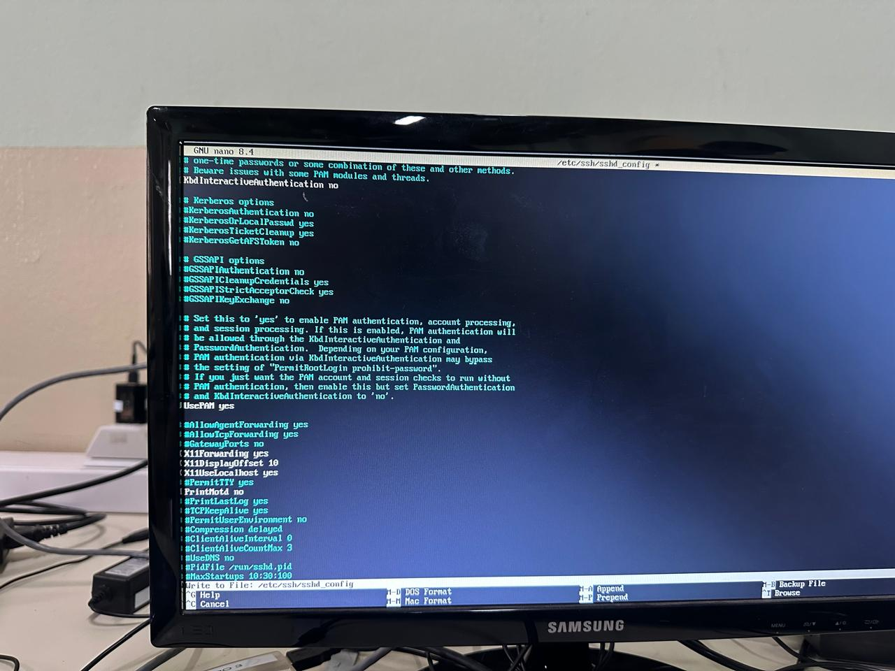
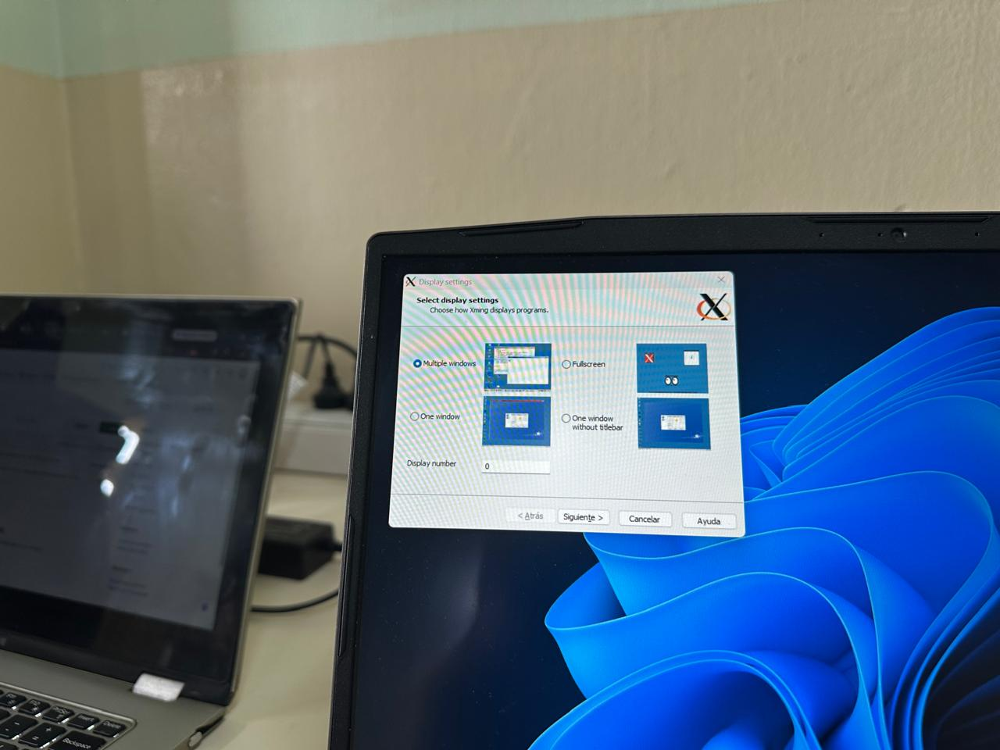
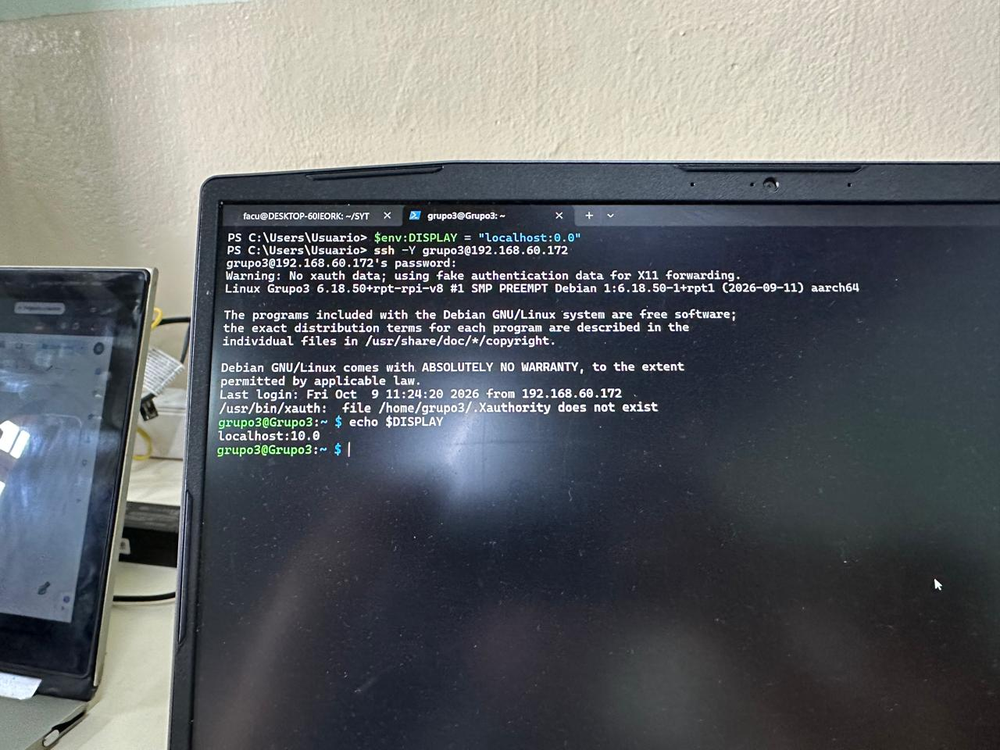
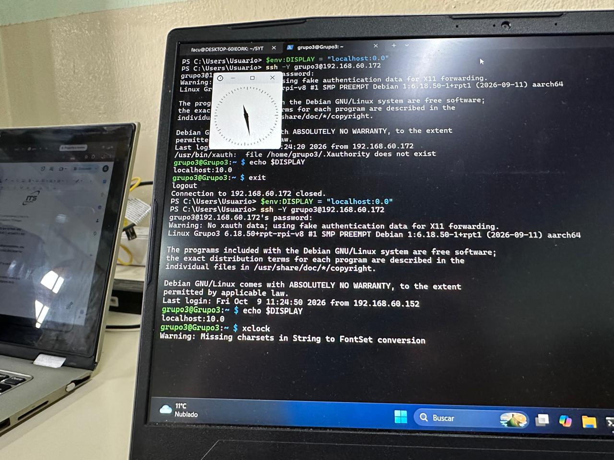

# Instalación del servidor gráfico Xorg y ejecución remota de aplicaciones gráficas por SSH

## Índice

- [Instalación del servidor gráfico Xorg y ejecución remota de aplicaciones gráficas por SSH](#instalación-del-servidor-gráfico-xorg-y-ejecución-remota-de-aplicaciones-gráficas-por-ssh)
  - [Índice](#índice)
  - [Introducción](#introducción)
  - [Objetivo del informe](#objetivo-del-informe)
- [Desarrollo teórico](#desarrollo-teórico)
  - [Servidor gráfico y Xorg](#servidor-gráfico-y-xorg)
  - [Gestor de ventanas y gestor de escritorio](#gestor-de-ventanas-y-gestor-de-escritorio)
  - [Modelo cliente-servidor de X11](#modelo-cliente-servidor-de-x11)
  - [X11 Forwarding sobre SSH](#x11-forwarding-sobre-ssh)
- [Instalación de Xorg](#instalación-de-xorg)
  - [Actualización de la lista de paquetes](#actualización-de-la-lista-de-paquetes)
  - [Instalación del servidor gráfico](#instalación-del-servidor-gráfico)
  - [Instalación de herramientas auxiliares](#instalación-de-herramientas-auxiliares)
- [Configuración de SSH para el reenvío de X11](#configuración-de-ssh-para-el-reenvío-de-x11)
  - [Edición del archivo de configuración](#edición-del-archivo-de-configuración)
  - [Reinicio del servicio SSH](#reinicio-del-servicio-ssh)
- [Preparación del equipo cliente](#preparación-del-equipo-cliente)
- [Prueba de funcionamiento](#prueba-de-funcionamiento)
  - [Conexión con reenvío de X11](#conexión-con-reenvío-de-x11)
  - [Verificación de la variable DISPLAY](#verificación-de-la-variable-display)
  - [Ejecución de una aplicación gráfica](#ejecución-de-una-aplicación-gráfica)
- [Conclusión](#conclusión)

---

## Introducción

En este informe se documenta el proceso realizado para instalar el servidor gráfico **Xorg** en una **Raspberry Pi** que funciona como servidor dentro de una red local, y para configurar el servicio **SSH** de modo que permita ejecutar aplicaciones gráficas de forma remota.

La Raspberry Pi utiliza **Raspberry Pi OS Lite (64-bit)**, una versión del sistema operativo sin entorno de escritorio. Por este motivo, no cuenta con la infraestructura necesaria para mostrar ventanas ni gráficos. En esta actividad se instaló únicamente el servidor gráfico, **sin gestor de ventanas ni gestor de escritorio**, y se habilitó el reenvío de X11 a través de SSH.

Gracias a esta configuración, es posible instalar aplicaciones gráficas en la Raspberry Pi y ejecutarlas desde una sesión SSH. La aplicación se ejecuta en la Raspberry Pi, pero la ventana se dibuja y se muestra en el equipo cliente desde el cual nos conectamos.

---

## Objetivo del informe

El objetivo de este informe es documentar el proceso de:

* Instalación del servidor gráfico **Xorg** en la Raspberry Pi, sin gestor de ventanas ni de escritorio.
* Instalación de las herramientas necesarias para el reenvío de X11 y para realizar pruebas.
* Configuración del servicio SSH para permitir el reenvío de X11.
* Preparación del equipo cliente para recibir las ventanas remotas.
* Comprobación del funcionamiento ejecutando una aplicación gráfica de prueba por SSH.

De esta manera, la Raspberry Pi queda preparada para ejecutar aplicaciones gráficas de forma remota, mostrando sus ventanas en el equipo cliente.

---

# Desarrollo teórico

## Servidor gráfico y Xorg

Un **servidor gráfico** es el programa encargado de gestionar la pantalla, el teclado y el mouse, y de proporcionar a las aplicaciones los mecanismos para dibujar ventanas y gráficos. Sin un servidor gráfico, las aplicaciones solo pueden trabajar en modo texto.

**Xorg** es la implementación más difundida del sistema de ventanas **X Window System** (también llamado **X11**) en sistemas Linux y Unix. Es el servidor gráfico que se instala en la Raspberry Pi durante esta actividad.

---

## Gestor de ventanas y gestor de escritorio

Es importante diferenciar estos conceptos, ya que la consigna solicita instalar solo el servidor gráfico:

* **Servidor gráfico (Xorg):** gestiona la pantalla y los dispositivos de entrada, y permite que las aplicaciones dibujen en ella.
* **Gestor de ventanas:** programa que controla cómo se muestran las ventanas (bordes, barra de título, minimizar, mover, etc.). Ejemplos: Openbox, i3.
* **Gestor de escritorio (entorno de escritorio):** conjunto completo que incluye gestor de ventanas, paneles, menús, íconos y aplicaciones asociadas. Ejemplos: GNOME, XFCE, LXDE.

En este trabajo **no se instaló ninguno de los dos últimos**, ya que las ventanas serán presentadas por el equipo cliente.

---

## Modelo cliente-servidor de X11

X11 funciona con un modelo **cliente-servidor**, con una particularidad que suele generar confusión:

* El **servidor X** es el programa que está conectado a la pantalla, al teclado y al mouse, es decir, el que **dibuja** las ventanas.
* El **cliente X** es la aplicación gráfica (por ejemplo, un reloj o un navegador) que solicita al servidor X que dibuje sus ventanas.

Como el cliente y el servidor se comunican por la red, la aplicación puede ejecutarse en un equipo (la Raspberry Pi) y mostrarse en otro (la notebook desde la que nos conectamos). En ese caso:

| Equipo | Rol en X11 | Qué hace |
|---|---|---|
| Raspberry Pi | Cliente X | Ejecuta la aplicación y envía las instrucciones de dibujo |
| Notebook (host cliente) | Servidor X | Recibe las instrucciones y genera las ventanas y gráficos |

---

## X11 Forwarding sobre SSH

El **X11 Forwarding** (reenvío de X11) es una característica de **SSH** que crea un túnel cifrado para transportar el tráfico de X11 entre la Raspberry Pi y el equipo cliente.

Al conectarse con esta opción activada, SSH:

1. Crea en la Raspberry Pi un servidor X "virtual" asociado a la variable de entorno `DISPLAY`.
2. Envía por el túnel SSH todo lo que las aplicaciones dibujen en ese `DISPLAY`.
3. Entrega esos datos al servidor X del equipo cliente, que genera la ventana localmente.

Esto tiene dos ventajas: el tráfico viaja **cifrado** y no es necesario abrir puertos adicionales ni configurar permisos de red complejos. Además, la Raspberry Pi no necesita monitor, ya que el procesamiento del video lo realiza el equipo cliente.

---

# Instalación de Xorg

Antes de comenzar, se accedió a la Raspberry Pi por terminal, ya sea de forma local o mediante una sesión SSH común.

## Actualización de la lista de paquetes

Primero se actualizó la lista de paquetes disponibles para asegurar que se instalen las versiones más recientes:

```bash
sudo apt update
```

### Explicación del comando

* `sudo`: ejecuta el comando con privilegios de administrador, necesarios para modificar el sistema.
* `apt`: es el gestor de paquetes de los sistemas basados en Debian, como Raspberry Pi OS. Permite instalar, actualizar y eliminar software.
* `update`: descarga desde los repositorios la lista actualizada de paquetes disponibles y sus versiones. **No instala ni actualiza programas**: solo actualiza el listado que `apt` consulta.

---

## Instalación del servidor gráfico

A continuación se instaló Xorg:

```bash
sudo apt install xorg
```

### Explicación del comando

* `sudo`: ejecuta la instrucción con privilegios de administrador.
* `apt`: gestor de paquetes del sistema.
* `install`: indica que se desea instalar uno o más paquetes junto con las dependencias que necesiten.
* `xorg`: es un **metapaquete** que instala el servidor gráfico Xorg y los componentes básicos asociados (controladores de video y de dispositivos de entrada, utilidades y bibliotecas de X11). No instala un gestor de ventanas ni un entorno de escritorio, por lo que se cumple lo solicitado en la consigna.

Durante la instalación se pide confirmación para descargar los paquetes; se responde con `Y` y se espera a que el proceso finalice.

---

## Instalación de herramientas auxiliares

Para que el reenvío de X11 funcione y para poder comprobarlo, se instalaron dos paquetes adicionales:

```bash
sudo apt install xauth x11-apps
```

### Explicación del comando

* `sudo apt install`: instala paquetes con privilegios de administrador (explicado anteriormente).
* `xauth`: herramienta que gestiona las **cookies de autorización** de X11. SSH la utiliza para autorizar a las aplicaciones remotas a dibujar en el servidor X del cliente. Si no está instalada, el reenvío de X11 no funciona.
* `x11-apps`: conjunto de aplicaciones gráficas muy livianas, como `xeyes` (unos ojos que siguen el cursor) y `xclock` (un reloj). Se utilizan únicamente para **probar** que el reenvío funciona.

---

# Configuración de SSH para el reenvío de X11

## Edición del archivo de configuración

El servicio SSH de la Raspberry Pi se configura mediante el archivo `/etc/ssh/sshd_config`. Se abrió con un editor de texto:

```bash
sudo nano /etc/ssh/sshd_config
```

### Explicación del comando

* `sudo`: ejecuta el comando con privilegios de administrador, necesarios para modificar archivos del sistema.
* `nano`: editor de texto de terminal, sencillo de utilizar.
* `/etc/ssh/sshd_config`: ruta del archivo de configuración del **servidor** SSH (`sshd`, el demonio SSH). No debe confundirse con `ssh_config`, que es el archivo de configuración del cliente.

Dentro del archivo se verificó que estuvieran presentes, sin el símbolo `#` al inicio (que comenta la línea), las siguientes opciones:

```text
X11Forwarding yes
X11DisplayOffset 10
X11UseLocalhost yes
```



> **Figura 1:** Archivo `/etc/ssh/sshd_config` abierto en el editor `nano` (GNU nano 8.4), con las opciones de X11.

### Explicación de las opciones

* `X11Forwarding yes`: habilita el reenvío de X11 en el servidor SSH. Es la opción fundamental.
* `X11DisplayOffset 10`: indica el número a partir del cual SSH asigna los displays virtuales (`localhost:10.0`, `localhost:11.0`, etc.). Se utiliza 10 para evitar conflictos con servidores X reales que usan números bajos.
* `X11UseLocalhost yes`: hace que el servidor X virtual escuche únicamente en la interfaz local de la Raspberry Pi. Esto es lo recomendable por seguridad, ya que impide que otros equipos de la red accedan a ese display.

Para guardar los cambios en `nano` se presiona `Ctrl + O` y `Enter`, y para salir `Ctrl + X`.

---

## Reinicio del servicio SSH

Para que los cambios surtan efecto, se reinició el servicio:

```bash
sudo systemctl restart ssh
```

### Explicación del comando

* `sudo`: ejecuta el comando con privilegios de administrador.
* `systemctl`: herramienta que permite consultar y administrar los servicios del sistema.
* `restart`: detiene el servicio y lo vuelve a iniciar, de modo que lea nuevamente su archivo de configuración.
* `ssh`: nombre del servicio sobre el que se actúa.

Luego se verificó que el servicio siguiera funcionando correctamente:

```bash
sudo systemctl status ssh
```

Esta instrucción consulta el estado del servicio (`status`). Debe mostrar **`active (running)`**.

---

# Preparación del equipo cliente

Como el equipo cliente es quien dibuja las ventanas, **necesita tener un servidor X en ejecución**. Según el sistema operativo del cliente:

| Sistema del cliente | Qué se necesita |
|---|---|
| Linux con entorno gráfico | Ya cuenta con un servidor X (Xorg o XWayland). No requiere instalar nada. |
| Windows | Instalar un servidor X, como **VcXsrv**, **Xming** o utilizar **MobaXterm**, que lo incluye. En Windows 11 con WSL, WSLg ya lo provee. |
| macOS | Instalar **XQuartz**. |

En este trabajo el equipo cliente utiliza **Windows**, por lo que se instaló y ejecutó **VcXsrv**. En la ventana de configuración (*Display settings*) se seleccionó la opción **Multiple windows**, que hace que cada aplicación remota se muestre en su propia ventana, integrada con el escritorio de Windows.



> **Figura 2:** Ventana *Display settings* de VcXsrv con la opción *Multiple windows* seleccionada.

---

# Prueba de funcionamiento

## Conexión con reenvío de X11

Con VcXsrv en ejecución, desde una terminal de **PowerShell** en el equipo cliente se ejecutaron los siguientes comandos:

```powershell
$env:DISPLAY = "localhost:0.0"
ssh -Y grupo3@192.168.60.172
```

Una vez dentro de la Raspberry Pi, se comprobó el valor de la variable `DISPLAY`:

```bash
echo $DISPLAY
```



> **Figura 3:** Terminal del equipo cliente con la definición de `DISPLAY`, la conexión por SSH con la opción `-Y` y la verificación de la variable.

### Explicación de los comandos

**`$env:DISPLAY = "localhost:0.0"`**

* `$env:`: en PowerShell, es el prefijo que permite leer o modificar **variables de entorno** de la sesión actual.
* `DISPLAY`: variable que indica a las aplicaciones gráficas (y al cliente SSH) en qué servidor X deben dibujar las ventanas.
* `"localhost:0.0"`: valor asignado, con el formato `host:display.pantalla`. Significa que el servidor X está en el propio equipo (`localhost`), es el display número `0` y la pantalla número `0`. Es la dirección en la que VcXsrv escucha por defecto.

Con esto, el cliente SSH de Windows sabe a qué servidor X debe entregar los datos gráficos que lleguen desde la Raspberry Pi. Esta variable se define solo para la sesión de PowerShell abierta.

**`ssh -Y grupo3@192.168.60.172`**

* `ssh`: cliente de Secure Shell, que permite conectarse de forma segura a otro equipo.
* `-Y`: habilita el reenvío de X11 en modo **confiable** (*trusted*). A diferencia de `-X`, no aplica las restricciones de seguridad adicionales de la extensión X11 SECURITY, lo que evita errores de compatibilidad con algunas aplicaciones. Solo debe usarse con equipos y redes de confianza, como en este caso, una red local.
* `grupo3`: usuario con el que se ingresa a la Raspberry Pi.
* `@`: separa el usuario de la dirección del equipo.
* `192.168.60.172`: dirección IP de la Raspberry Pi dentro de la red local.

**`echo $DISPLAY`**

* `echo`: muestra en pantalla el texto o valor que recibe.
* `$DISPLAY`: contenido de la variable `DISPLAY`. El signo `$` hace que se muestre su valor y no su nombre.

Este comando se ejecuta **dentro de la sesión SSH**, es decir, en la Raspberry Pi. Si el reenvío funciona, el resultado es similar a `localhost:10.0`, valor que SSH asigna automáticamente al display virtual del túnel (por la opción `X11DisplayOffset 10` configurada antes). Si la salida está vacía, el reenvío de X11 no se activó, por ejemplo por no tener instalado `xauth` o por no haber usado `-X` o `-Y`.

---

## Ejecución de una aplicación gráfica

Finalmente, dentro de la sesión SSH, se ejecutó una aplicación gráfica de prueba:

```bash
xclock
```



> **Figura 4:** Terminal del equipo cliente con los comandos anteriores y la ejecución de `xclock` dentro de la sesión SSH.

### Explicación del comando

* `xclock`: aplicación gráfica incluida en el paquete `x11-apps`. Muestra un reloj analógico en una ventana.

La aplicación se **ejecuta en la Raspberry Pi**, pero la ventana **aparece en el equipo cliente**, lo que confirma que el reenvío de X11 funciona. Mientras `xclock` está abierto, la terminal queda ocupada; se cierra la ventana o se presiona `Ctrl + C` para volver al prompt.

También puede probarse con `xeyes`, otra aplicación del mismo paquete que muestra unos ojos que siguen el cursor.

Para ejecutar una aplicación sin bloquear la terminal, puede añadirse `&` al final del comando:

```bash
xclock &
```

* `&`: ejecuta el programa en segundo plano, permitiendo seguir utilizando la terminal.

---

# Conclusión

A partir de esta actividad se logró instalar el servidor gráfico **Xorg** en la Raspberry Pi, sin gestor de ventanas ni gestor de escritorio, cumpliendo con la consigna. Además, se instalaron `xauth` y `x11-apps`, necesarios para el reenvío y para las pruebas.

Se configuró el servicio **SSH** habilitando `X11Forwarding` en el archivo `sshd_config`, y se reinició el servicio para aplicar los cambios. En el equipo cliente fue necesario contar con un servidor X, ya que es el encargado de dibujar las ventanas.

Finalmente, se comprobó el funcionamiento definiendo `DISPLAY` en el cliente, conectándose con `ssh -Y`, verificando la variable `DISPLAY` en la Raspberry Pi y ejecutando `xclock`. La aplicación corrió en la Raspberry Pi y su ventana se mostró en el equipo cliente.

Como aprendizaje principal, se comprendió que en X11 los roles de cliente y servidor son inversos a lo que suele esperarse: **el servidor X es quien tiene la pantalla** y la aplicación es el cliente. Gracias a esto, la Raspberry Pi puede funcionar sin monitor y dejar el procesamiento gráfico al equipo cliente, lo que resulta muy útil para administrarla de forma remota dentro de la red local.
